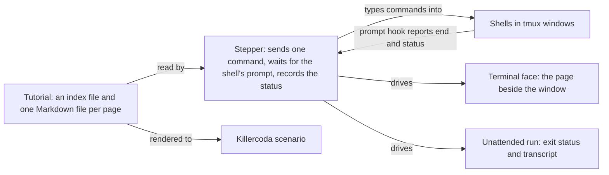

# tutorial-stepper

Steps a Markdown tutorial's commands into real shells, one at a time, beside the page that explains
them.

## Who it is for

**A learner** installs a tutorial and plays it in their own terminal. Before the first page they
choose the tutorial's settings, for example a shorter wait or another way to sign; any combination is
allowed, and the page says when one is not among those the author tests. The page sits beside the window
where the command runs; Enter runs the next command there, `e` places it at the prompt to edit first.
When a command ends with a status the page did not expect, the page says so. Commands that only look
at what happened, such as a wallet's balance or the chain's view of a transaction, stay on a list the
learner can run from at any time without losing their place. Once the explanations are understood,
they fold away and only the commands remain to step through.

**A tutorial author** writes plain Markdown, with the commands in ordinary code blocks, declares the
settings and which combinations of them are tested, and gets three things from one source: the
tutorial their learners play locally, an unattended run of each tested combination that fails in CI
when the tutorial stops working, and a Killercoda scenario per tested combination.



## What a step looks like

A block says which window it runs in and which exit status it expects, in the code fence itself:

````markdown
**Bob builds the fold** (it exits with status 19: nothing is sent yet).

```bash { window=bob status=19 }
open-datum fold --wallet-address "$bob_addr" --bundle bundles/fold.bundle
```
````

GitHub, Pandoc and MkDocs show this as an ordinary bash block.

## Status

No code yet. The principles every change follows are in the
[constitution](.specify/memory/constitution.md). The first consumer is the
[Singular demo](https://github.com/lambdasistemi/singular-demo), whose terminal tutorial this project
replaces.
