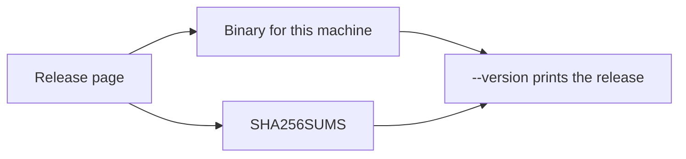
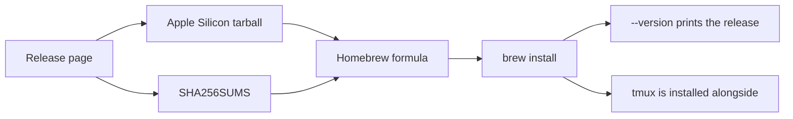
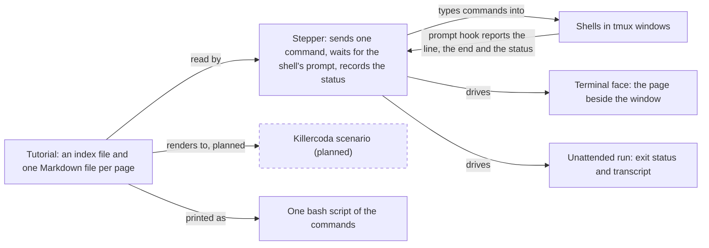

# tutorial-stepper

Steps a Markdown tutorial's commands into real shells, one at a time, beside the page that explains
them.

## Who it is for

**A learner** installs a tutorial and plays it in their own terminal. Before the first page they
choose the tutorial's settings, for example a shorter wait or another way to sign; any combination is
allowed, and the page says when one is not among those the author tests. Choosing again starts a new
run and keeps the earlier folder. The page sits beside the window
where the command runs; Enter runs the next command there, `e` places it at the prompt to edit first.
When a command ends with a status the page did not expect, the page says so. Commands that only look
at what happened, such as a wallet's balance or the chain's view of a transaction, stay on a list.
The learner presses `o`, sees the observations already reached, and runs one without losing their
place. Once the explanations are understood,
they press `f` and only the commands remain, each with its window. `f` again brings the
explanations back.

**A tutorial author** writes plain Markdown, with the commands in ordinary code blocks, declares the
settings and which combinations of them are tested, and gets three things from one source: the
tutorial their learners play locally, an unattended run of each tested combination that fails in CI
when the tutorial stops working, and, once the Killercoda renderer lands in a later milestone,
a Killercoda scenario per tested combination. From the same
source, `tutorial-stepper script` prints one bash script, each command named with its page and its
window, for reading, diffing, and a quick run outside the stepper.
[paolino/runmd](https://github.com/paolino/runmd) is superseded by `tutorial-stepper script`.

## Install on Linux

A learner without Nix downloads the binary for their machine from the
[release page](https://github.com/lambdasistemi/tutorial-stepper/releases),
checks it against the checksums published with that release, and runs it.



The release carries two statically linked Linux files and one checksum
file. The checksum file also lists the Apple Silicon archive. `<version>`
is the version `--version` prints.

- `tutorial-stepper-<version>-x86_64-linux`
- `tutorial-stepper-<version>-aarch64-linux`
- `SHA256SUMS`

```bash
sha256sum -c SHA256SUMS
chmod +x tutorial-stepper-<version>-x86_64-linux
./tutorial-stepper-<version>-x86_64-linux --version
./tutorial-stepper-<version>-x86_64-linux check examples/one-window
```

On arm64 the file name ends in `aarch64-linux`, and the same commands
apply. Playing a tutorial still needs tmux and bash or zsh. The binary
does not bring them, and it installs nothing. `check` needs neither.

## Install on macOS

A learner on an Apple Silicon Mac installs the stepper with Homebrew.
The formula also installs tmux, which playing a tutorial needs.
`tutorial-stepper --version` prints the release.



The release archive is
`tutorial-stepper-<version>-aarch64-darwin.tar.gz`. `SHA256SUMS` lists
that archive and the two Linux binaries. `<version>` is the version
`--version` prints.

```bash
brew install lambdasistemi/tap/tutorial-stepper
tutorial-stepper --version
```

Intel Macs are not built. The binary is not signed with an Apple
Developer ID, and it is not notarised. The bash that ships with macOS
is too old to play a tutorial. Homebrew's bash works, and so does the
zsh that ships with macOS. `check` needs neither a shell nor tmux.



## What a step looks like

A block says which window it runs in and which exit status it expects, in the code fence itself:

````markdown
**Bob builds the fold** (it exits with status 19: nothing is sent yet).

```bash { window=bob status=19 }
open-datum fold --wallet-address "$bob_addr" --bundle bundles/fold.bundle
```
````

GitHub, Pandoc and MkDocs show this as an ordinary bash block.

## Status

`tutorial-stepper check` reads a tutorial directory and reports format problems.
`tutorial-stepper script` prints its runnable commands as one bash script.
[paolino/runmd](https://github.com/paolino/runmd) is superseded by that command.
Version 0 of the format is [docs/format.md](docs/format.md), and the script
command is [docs/script.md](docs/script.md). `tutorial-stepper play DIR` plays a tutorial page by page in the terminal; that command is [docs/terminal.md](docs/terminal.md). `tutorial-stepper play --auto` plays a tutorial unattended, in the shell and the windows the index declares, and writes a transcript; that command is [docs/play.md](docs/play.md). An observation runs where it appears and again at the end of each path. Without `--path`, a tutorial that declares tested paths plays each of them from a clean run folder and exits non-zero when any path fails. The principles every change follows are in the
[constitution](.specify/memory/constitution.md). The first consumer is the
[Singular demo](https://github.com/lambdasistemi/singular-demo), whose terminal tutorial this project
replaces.
