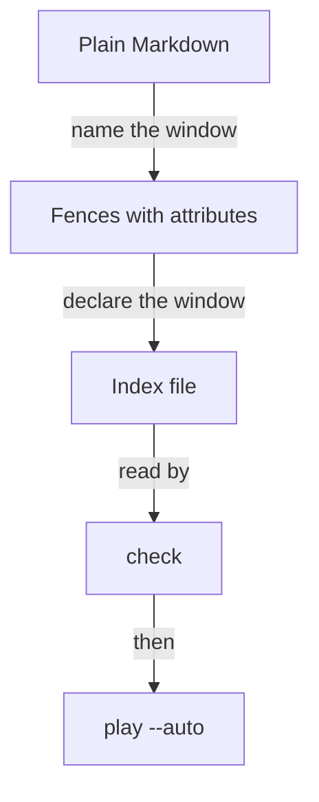

# From a Markdown page to a run in continuous integration

A tutorial author starts from a page of prose and commands and ends with a directory that `tutorial-stepper play --auto` can run. The same command is what continuous integration runs. When it exits non-zero, the tutorial has stopped working.

## Who it is for

The author of a plain Markdown tutorial. The page they already have is the source. Nothing is copied into a second recipe.



The worked example is the tutorial in `examples/one-window`. The steps below are that directory, written out.

## A fence without braces is not a command

This is an ordinary code block. The stepper does not read it, and `check` does not count it.

````markdown
```bash
echo hi
```
````

## Name the window on the fence

Attributes are written only as `lang { key=value }`. A fence with braces and no `mode` is a command. This is `welcome.md`.

````markdown
```bash { window=bob }
echo hi
```
````

`window` names a window the index declares. When `status` is absent, the expected status is 0. `mode=show` is only shown. `mode=observe` is an observation the learner can run without losing their place. `if=NAME:value` belongs to one value of a setting.

A block that is shown and never run:

````markdown
```text { window=bob mode=show }
shown, not run
```
````

Any other spelling is a format error. A JSON object, bare words after the language, and a Pandoc class are rejected. [Checking a tutorial's format](format.md) is the specification.

## Declare the window in the index

The index is `tutorial.toml` beside the page. `pages` lists the pages in order. Each window has a name and a folder.

```toml
pages = ["welcome.md"]

[[window]]
name = "bob"
folder = "bob"
```

`check` does not run `echo hi`. It reports the shape.

```bash
tutorial-stepper check examples/one-window
```

A sound directory prints `1 page, 1 command` and exits 0.

## Play it unattended

The unattended run types the command into bob's shell and waits until the shell's prompt says it ended. The transcript records the command, its output, its status, and its time.

```bash
tutorial-stepper play --auto examples/one-window --transcript transcript.toml
```

The run needs tmux, and bash or zsh. It installs nothing. A status other than the one the fence declares exits 1 and names the block. The transcript is then the record of how far the run got.

Continuous integration runs that same command from a clean directory. A non-zero exit fails the job. The job needs the stepper, tmux, and the shell the index names. It does not need a person.

Settings, tested paths, observations, and the set-up script are specified in [the format](format.md) and in [Playing a tutorial unattended](play.md). A tutorial that uses them still starts from the two files above.
