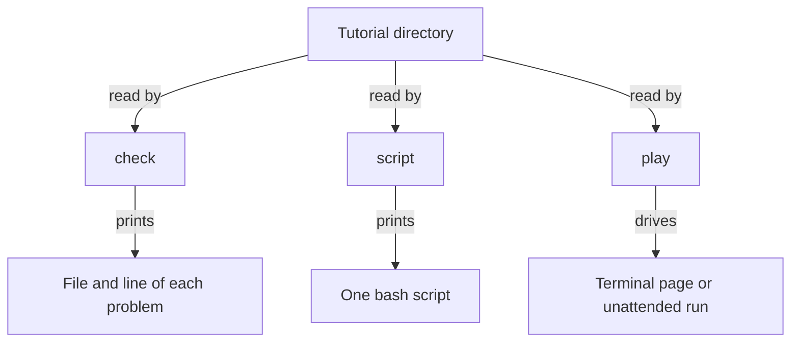

# The commands

`tutorial-stepper` reads a tutorial directory. The directory holds `tutorial.toml` and one Markdown page per step. Three commands share that directory: `check` reports the format, `script` prints the commands, and `play` steps them into real shells.

## Who it is for

The author, who checks a tutorial and runs it unattended, and the learner, who plays it at the keyboard. A sound tutorial exits 0. Each format problem is printed as `FILE:LINE: message` and the command exits 1. A mistake in the command line exits 2.



Running `tutorial-stepper` with no command prints the same summary as `--help`.

## check

`tutorial-stepper check DIR` reads the directory and runs nothing. A sound tutorial prints one line, the number of pages and the number of commands, for example `1 page, 2 commands`.

```bash
tutorial-stepper check examples/one-window
```

The format it checks is [Checking a tutorial's format](format.md).

## script

`tutorial-stepper script DIR` prints the runnable commands as one bash script. The first line is `#!/usr/bin/env bash`. A comment before each command names its page and its window. A block marked `mode=show` is left out. An observation is included where it appears. The command itself runs nothing.

`--path NAME` prints one tested path and leaves the other branches out. Without `--path`, every branch is printed.

```bash
tutorial-stepper script examples/one-window
tutorial-stepper script examples/if --path external
```

The full account is [Printing a tutorial as one script](script.md).

## play

`tutorial-stepper play DIR` plays the tutorial in the learner's terminal. The page sits beside the window of the next command.

| Key | What it does |
| --- | --- |
| Enter | Run the next command |
| `e` | Place the command at the prompt, to edit first |
| `f` | Fold the explanations away, or bring them back |
| `o` | List the observations already reached, and run one |
| `s` | Skip the command |
| `c` | Send Ctrl-C to the running command |
| `b` | Go back to the previous command |
| `n`, `p` | Turn the page |
| `q` | Close the page and keep the windows |

A later `play` of the same tutorial returns to the same place. The run folder is `$HOME/<name>-run` unless `--run DIR` names another. Choosing the settings again, with `n`, starts a new run and keeps the earlier folder.

```bash
tutorial-stepper play examples/two-windows
```

The full account is [Playing a tutorial in the terminal](terminal.md).

`tutorial-stepper play --auto DIR --transcript FILE` plays with nobody at the keyboard. `--transcript` is required. The shell is the one the index declares, bash when the index does not say. An observation runs where it appears and again at the end of the path. `--path NAME` plays that tested path. Without `--path`, every tested path plays from its own run folder, and the command exits 1 if any path fails. `--run-setup` runs the declared set-up script before the first command. `--transcript`, `--path`, and `--run-setup` are used with `--auto`.

```bash
tutorial-stepper play --auto examples/one-window --transcript transcript.toml
```

The full account is [Playing a tutorial unattended](play.md).
