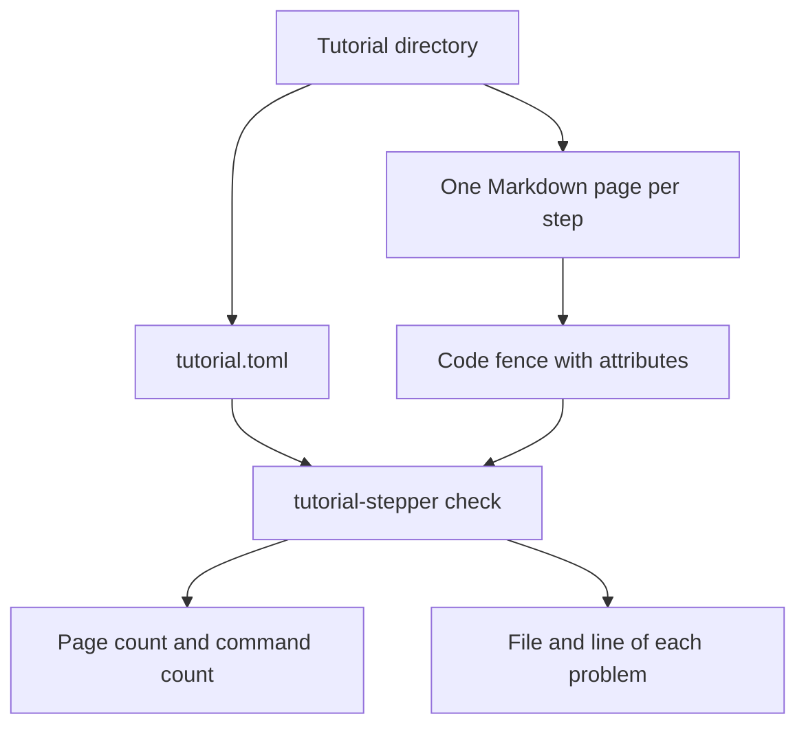

# Checking a tutorial's format

A tutorial author keeps one directory: an index file, and one Markdown page per step. Before anyone plays the tutorial, the author runs `tutorial-stepper check` on that directory. Version 0 of the format either prints how many pages and commands the directory contains, or prints every problem with its file and line. Nothing in the tutorial is executed.

## Who it is for

The author, who wants a broken tutorial rejected before a learner sees it. The same check is what continuous integration runs on the examples in this repository.



## The index

The index is `tutorial.toml` at the tutorial root. Top-level keys come before every table. `shell`, `setup`, and `[[setting]]` may be left out. `pages` and at least one `[[window]]` are required.

```toml
shell = "bash"
setup = "setup.sh"
pages = ["welcome.md", "build.md"]

[[window]]
name = "alice"
folder = "alice"
needs = ["singular >= 0.14.0", "jq"]

[[window]]
name = "bob"
folder = "bob"
needs = ["singular >= 0.14.0"]

[[setting]]
name = "SIGNING"
default = "external"
values = ["external", "internal"]

[[path]]
name = "external"
values = { SIGNING = "external" }

[[path]]
name = "internal"
values = { SIGNING = "internal" }
```

`shell` is `bash` or `zsh`. When it is absent, the shell is bash. `setup` is a relative path to the set-up script. Each window has a `name`, a `folder` relative to the run folder, and `needs`: a program name, or a program name followed by `>=` and a version. A setting has a name, a default, and the values allowed; the default is one of those values. A path is one tested combination: a name, and one allowed value for every setting. Names and setting values are single words.

When the tutorial is played, the values in force are written to `.env` in the run folder before any window opens. The file is one `NAME=value` line per setting, in the order the settings are declared, with a newline after each line. There is no `export`, no quotes, and no blank line. Values are single words, so nothing is quoted. [Playing a tutorial unattended](play.md) says when the file is written and how a window loads it.

`check` parses `needs` and `setup` and checks that shape. It does not run the script and it does not look up the programs. `play` looks up each needed program before the set-up script. A minimum version is the first dotted number in the text `PROGRAM --version` prints on either stream: digits, then at least one `.digits` group. Components compare as integers, and a missing component is 0. A program that prints no dotted number stops the run, and the message says so. A need with no minimum does not run the program. `play` runs the set-up script only with `--run-setup`, in the run folder, before the first page, as the user who started it.

A key the format does not define is an error at that key's line. So is a page that is listed but missing, a Markdown page in the directory that is not listed, a setting whose default is not allowed, a path that misses a setting or names an unknown one or gives a value that is not allowed, and a second window, setting, or path with a name already used.

## A page

A page is ordinary CommonMark. The commands are fenced code blocks. The words around them are the explanation. A fence with a language and no braces is an ordinary code block: it is not a command, and it is not an error.

## Attributes

Attributes are written only in the fence's info string, after the language, as `{ key=value }`. Values are single words. The keys are `window`, `status`, `mode`, and `if`.

`window` names a window the index declares.

````markdown
```bash { window=bob }
echo hi
```
````

`status` is the exit status the block is expected to end with: a non-negative integer that fits in one byte. When `status` is absent, the expected status is 0.

````markdown
```bash { window=bob status=19 }
echo not yet
```
````

`mode` is `show` or `observe`. `show` means the block is only shown. `observe` means the block is an observation the learner can run without losing their place. When `mode` is absent, the block is a command to run.

````markdown
```text { window=bob mode=show }
shown
```
````

````markdown
```bash { window=bob mode=observe }
echo observed
```
````

`if` is `NAME:value`. `NAME` is a setting the index declares, and `value` is one of that setting's values. When `if` is absent, the block is shared by every setting.

````markdown
```bash { window=alice if=SIGNING:external }
echo external
```
````

A command is an attributed fence with no `mode`. On success, `check` prints one line on standard output, for example `1 page, 2 commands`, and exits 0. Each problem goes to standard error as `FILE:LINE: message`, and the command exits 1. The file is the directory that was named, joined with the page or with `tutorial.toml`.

`tutorial-stepper script` prints those commands, and the observations, as one bash script. A block marked `mode=show` is left out. The reference is [Printing a tutorial as one script](script.md). `tutorial-stepper play --auto` runs the commands in the windows the index declares, in the shell the index declares, and writes a transcript. An absent shell is bash. The reference is [Playing a tutorial unattended](play.md).

Any other spelling is an error at that fence's line. A JSON object (`{"window":"bob"}`), bare words after the language (`bash window=bob`), and Pandoc's braced class (`{.bash …}`) are all rejected. So is an unknown attribute, a `status` that is not an integer, a `mode` other than `show` or `observe`, and an `if` that is not `NAME:value`.

The tutorials under `examples/` follow this format. The tutorials under `examples/invalid/` are one broken directory per problem.
