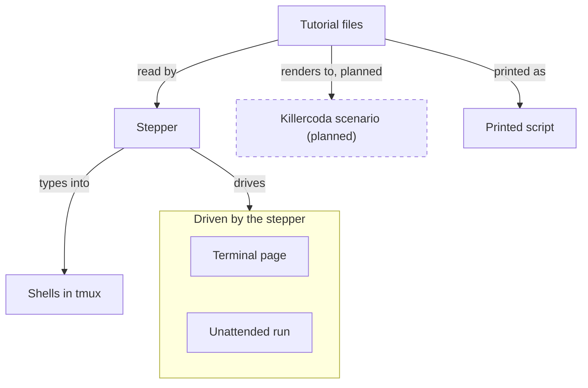

# tutorial-stepper

tutorial-stepper takes a tutorial written in Markdown and steps its commands into real shells, one at a time, beside the page that explains them. It knows when each command ended and with what status, so the same tutorial a learner follows by hand also runs unattended as a test.

## Who it is for

### A learner

A learner installs a tutorial and plays it in their own terminal. Before the first page they choose the tutorial's settings, for example a shorter wait or another way to sign. Any combination is allowed, and the page says when one is not among those the author tests. Choosing again starts a new run and keeps the earlier folder.

The page sits beside the window where the command runs. Enter runs the next command there. `e` places it at the prompt to edit first. When a command ends with a status the page did not expect, the page says so.

Commands that only look at what happened, such as a wallet's balance or the chain's view of a transaction, stay on a list. The learner presses `o`, sees the observations already reached, and runs one without losing their place. Once the explanations are understood, they press `f` and only the commands remain, each with its window. `f` again brings the explanations back.

The terminal page is described in [Playing a tutorial in the terminal](terminal.md).

### A tutorial author

A tutorial author writes plain Markdown, with the commands in ordinary code blocks, and declares the settings and which combinations of them are tested. One source then gives three things: the tutorial learners play locally, an unattended run of each tested combination that fails in continuous integration when the tutorial stops working, and, once the Killercoda renderer lands in a later milestone, a Killercoda scenario per tested combination.

From the same source, `tutorial-stepper script` prints one bash script, each command named with its page and its window, for reading, diffing, and a quick run outside the stepper. [paolino/runmd](https://github.com/paolino/runmd) is superseded by that command.

The format is [Checking a tutorial's format](format.md). The unattended run is [Playing a tutorial unattended](play.md). The printed script is [Printing a tutorial as one script](script.md).

## How the pieces meet

The author writes an index file and one Markdown file per page. The stepper reads that tutorial. It types one command at a time into shells hosted by tmux, and the shell's prompt reports when the command ended and with what status. The same stepper drives the terminal page a learner watches and the unattended run continuous integration records. A later milestone renders the tutorial to a Killercoda scenario; today it is printed as one bash script. The stepper does not install anything, and it does not use the network.



## Install

A learner without Nix downloads the binary for their machine from the [release page](https://github.com/lambdasistemi/tutorial-stepper/releases), checks it against the checksums published with that release, and runs it. The release carries `tutorial-stepper-<version>-x86_64-linux`, `tutorial-stepper-<version>-aarch64-linux`, and `SHA256SUMS`. `<version>` is the version `--version` prints. Playing a tutorial still needs tmux and bash or zsh. The binary does not bring them.

```bash
sha256sum -c SHA256SUMS
chmod +x tutorial-stepper-<version>-x86_64-linux
./tutorial-stepper-<version>-x86_64-linux --version
```

On arm64 the file name ends in `aarch64-linux`. A learner on an Apple Silicon Mac installs the stepper with Homebrew. The formula also installs tmux.

```bash
brew install lambdasistemi/tap/tutorial-stepper
tutorial-stepper --version
```

Intel Macs are not built. The binary is not signed with an Apple Developer ID, and it is not notarised. The bash that ships with macOS is too old to play a tutorial. Homebrew's bash works, and so does the zsh that ships with macOS.

## Where to go next

Read the [format](format.md), then the [commands](commands.md). The [author's guide](author.md) takes a plain Markdown page to a tutorial that plays unattended. A learner's session is [the terminal page](terminal.md). The unattended run is [played from the command line](play.md), and the same source [prints as one script](script.md). The generated [library reference](library.md) is the public Rust API of this revision.
