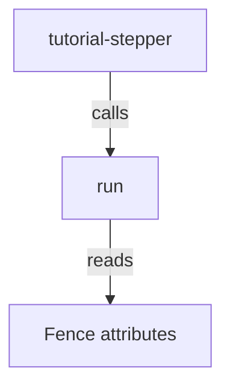

# The library

The binary `tutorial-stepper` is a thin wrapper. Stepping lives in the library, and the reference below is generated from the same revision as this site.

## Who it is for

A person reading the source, or calling the library from Rust. The crate is not published. This page is the reference.

`run` is what the binary calls. It parses the command line and dispatches `check`, `script`, and `play`. `fence` reads a page and returns the attributed fences, plus every fence that is neither an ordinary code block nor `lang { key=value }`. The rest of the crate is private to that implementation.

The pages under the frame link to each type, each function, and the source.

<a href="../api/tutorial_stepper/index.html">Open the library reference on its own.</a>

<iframe title="Library reference" src="../api/tutorial_stepper/index.html" style="width: 100%; min-height: 70vh; border: 0;"></iframe>
