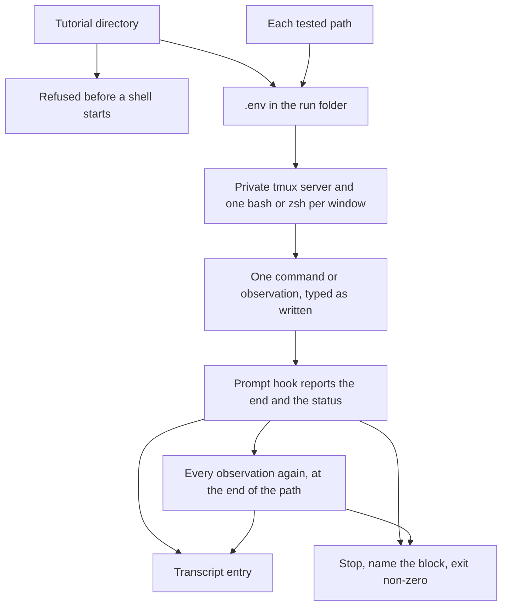

# Playing a tutorial unattended

A tutorial author runs `tutorial-stepper play --auto` on a tutorial directory and names a transcript file. The stepper starts its own tmux server, one shell per window the index declares, types each command into that window's shell, and waits until that shell's prompt says the command ended. The shell is zsh when the index says `shell = "zsh"`, and bash otherwise. The transcript records every command that ran, and every observation run. When a block exits with a status it did not declare, the run stops and names that block.

## Who it is for

The author, who wants the tutorial to run with nobody at the keyboard, whether the learners' shell is bash or zsh. Continuous integration runs the same command on the examples in this repository, under both shells. A learner plays the tutorial in their own terminal with `tutorial-stepper play DIR`, described in [Playing a tutorial in the terminal](terminal.md).



A format problem, or a set-up script the author did not ask to run, is refused before a shell starts. So is a program named in `needs` when it is missing, older than the declared minimum, or prints no version. The transcript file is not created. Anything else reaches the shell. An observation is typed where it stands on the page. When that path's blocks are done, every observation runs once more, and that second run is its own transcript entry. When the index declares tested paths and `--path` is absent, each path repeats from `.env` in its own clean run folder. A path that fails does not skip the later paths.

## What runs

```bash
tutorial-stepper play --auto examples/one-window --transcript transcript.toml
```

`--auto` and `--transcript` are both required. `--path NAME` plays that one tested path and prints `1 command played` or `N commands played`. Without `--path`, every tested path plays, and a path that played through prints `NAME: N commands played`. A sound run leaves standard error empty and exits 0. The command exits 1 when a path fails.

## The values in force

`--path NAME` takes the values of that tested path. The stepper writes them to `.env` in the run folder after the folder is created and before any window opens. One line per setting, in the order the index declares the settings:

```text
SIGNING=external
PACE=slow
```

There is no `export`, no quotes, and no blank line. A newline follows each line, including the last. Values are single words, which is why nothing is quoted. A tutorial with no settings writes no `.env`.

Each window's shell sources that file while it is starting, with every assignment exported, and only then installs the prompt hook. The load is not a command on a page, and it is not a transcript entry. A command on the page can read the variables. The transcript of a tested path adds `path`, set to that path's name, as the first key of each command.

A name that is not a tested path is refused before a shell starts and before the run folder is created. The message is `tutorial.toml:1: path "NAME" is not a tested path`. Nothing is written.

Without `--path`, a tutorial that declares tested paths plays each of them, in the order the index lists them. Each path starts from a clean run folder. With `--run DIR`, that folder is `DIR/<name>`, and `DIR` itself must be missing or empty. Without `--run`, each path's folder is temporary. A path that fails is reported, and the next path still starts. Standard error prints the failure this command already prints, with the path's name and a colon before the first line only. The command exits 1 if any path fails. The transcript is written once, after the paths that started a shell, and each command carries `path`.

A tutorial that declares no tested path plays once. When it declares settings, `.env` holds the defaults, and a block marked `if=` runs only for the default it names. The report is `N commands played`, with no path name, and the transcript has no `path` key.

The stepper looks up `tmux` on `PATH`, then the shell the index declares: `zsh` when the index says so, and `bash` otherwise. The first one missing is named, and nothing is started. A zsh tutorial that runs its set-up script also needs `bash`, because that script is bash. The server uses its own socket and does not read a tmux configuration file. Each declared window is one shell of that kind, started in that window's folder under the run folder. Without `--run` the run folder is temporary and is removed when the run ends. `--run DIR` keeps that directory: a missing `DIR` is created, an empty directory is used, and a directory that already holds anything is refused without being changed. A `DIR` that is a file is refused.

When the index names a set-up script, it runs only with `--run-setup`. The script is `bash` on that file, in the run folder, after each window folder exists and before any page command. It runs as the user who started `play`. The stepper does not raise privileges and does not invoke `sudo` or `su`. On success the script's own output is discarded, and the confirmation stays the count of page commands. A script that exits with another status stops the run: the message names the script and that status, and no page command runs. A script path that is not a file is named, and nothing is typed. Without `--run-setup` the run stops before any command and names the script. `--run-setup` on a tutorial that names no script changes nothing. When the effective user is root, that script is refused before the needs check, the run folder, and the script itself. The message names the script and says it would run as root. The needs check and the page commands may run as root.

Before that script, and before the run folder is created, every `needs` entry is checked. Windows are checked in index order, and each window's entries in the order written. The first failure is the only one reported. A program that is not on `PATH` stops the run: the message names it and says it was not found. A minimum version runs `PROGRAM --version` and reads standard output and standard error as one text. The version is the first dotted number in that text, digits with at least one further group of `.digits`, matching `[0-9]+(\.[0-9]+)+`. `GNU bash, version 5.2.15(1)-release` yields `5.2.15`. The declared minimum is read the same way. The two numbers are compared component by component, as integers, and a missing component is 0, so `1.2` equals `1.2.0` and `1.10` is newer than `1.9`. An older program stops the run. The message names the program, the dotted number that was found, and the version the index requires. When the text contains no dotted number, the message names the program and says it printed no version. A need with no minimum checks that the program is on `PATH` and does not run it.

The shell loads the stepper's prompt hook. Bash reports from `PROMPT_COMMAND`. zsh reports from `precmd`. Either way the hook records the line the shell accepted and appends the exit status of the command that just ended, before the prompt is drawn. A command of several lines is sent as one bracketed paste, then Enter, so the shell runs it as one command. The stepper does not decide that a command ended by a deadline or by reading the output: a command that sleeps is waited out. The server is gone when the run ends, whether the run passed or failed.

Commands and observations run in index page order, then fence order. A block marked `window=NAME` runs in that window. A block that names no window runs in the window of the previous command, and the first such block runs in the first window the index declares. An observation does not change the window a later command inherits. A block marked `mode=show` is not run and does not change that window. After the last block of the path, every observation that belongs to the path runs again, in that same order and in the same windows. A directory change stays in the shell that ran it. A fence body is one block, including a command continued over several lines. A fence with no braces is not run and does not appear in the transcript. An absent `status` expects 0. The first block whose reported status differs is the last one recorded. Later blocks, including the runs at the end, are not run. Standard output is empty. Standard error names the page, the line, and the command that ran. A command says `command exited`. An observation says `observation exited`, and a failure of the run at the end adds that it was at the end of the path. The command exits 1.

A tutorial that `tutorial-stepper check` rejects prints the same problems and creates no transcript. The same is true of a tutorial this command refuses before starting a shell:

- The tutorial declares a set-up script and `--run-setup` was not given. The message names the script. The script is not run.
- The tutorial declares a set-up script, `--run-setup` was given, and the effective user is root. The message names the script and says it would run as root. The script is not run.
- `--path` names a path the index does not declare. The message names that path. The run folder is not created.

## The transcript

The transcript is TOML. It is written only after a shell has started, and it is written whether the run passed or a block's status did not match. One table per block that ran, in that order. A command is `[[command]]`. An observation is `[[observation]]`, and the run at the end of the path is a second table, not a second status on the first.

```toml
[[command]]
page = "welcome.md"
window = "bob"
block = 1
command = "echo hi\n"
status = 0
start = "2026-10-22T21:07:53.123456789Z"
end = "2026-10-22T21:07:53.456789012Z"
output = "hi\n"

[[observation]]
page = "look.md"
window = "bob"
block = 5
command = "test -s note && echo seen\n"
status = 0
start = "2026-10-22T21:07:53.123456789Z"
end = "2026-10-22T21:07:53.456789012Z"
output = "seen\n"
position = "welcome.md:1"
```

`page` is the path listed in the index. `window` is the window the block ran in. `block` is the line of the opening fence. `command` is the line the prompt hook reported. It ends with a newline. When nobody edited the block, that line is the fence body. Bash and zsh report the same line. `status` is the exit status the prompt hook reported. `start` is the UTC time just before the block is typed, and `end` is the UTC time when the hook reports the end. Both are written `YYYY-MM-DDTHH:MM:SS.NNNNNNNNNZ`. `output` is the text the block wrote, without the prompt. A block that prints its working directory shows the window folder there. A block that writes nothing has an empty output. A run that plays nothing writes an empty file. A tested path writes `path` first, set to that path's name. A run that is not a tested path writes no `path` key.

`position` is only on an observation. Where the observation appears on the page, it is the page and the line of the command that ran before it, written `PAGE:LINE`. When no command of the path has run yet, it is `start of path`. On the run at the end, it is `end of path`. `N commands played` counts commands. An observation is not in that count.

A mistake in the command line exits 2. `tutorial-stepper play --help` describes the command.

The attributes are specified in [Checking a tutorial's format](format.md).
