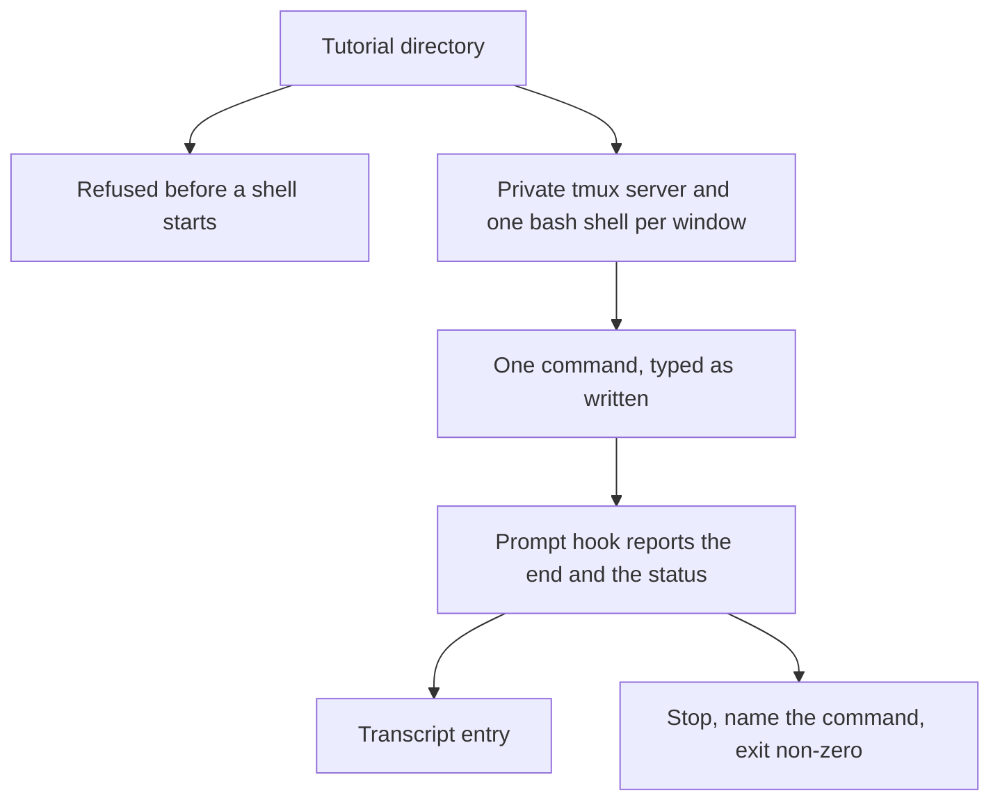

# Playing a tutorial unattended

A tutorial author runs `tutorial-stepper play --auto` on a tutorial directory and names a transcript file. The stepper starts its own tmux server, one bash shell per window the index declares, types each command into that window's shell, and waits until that shell's prompt says the command ended. The transcript records every command that ran. When a command exits with a status the block did not declare, the run stops and names that command.

## Who it is for

The author, who wants the tutorial to run with nobody at the keyboard. Continuous integration runs the same command on the examples in this repository. A learner's interactive session is not this command, and neither is a tutorial whose shell is zsh.



A format problem, zsh, a set-up script, or a command marked with a setting is refused before a shell starts. The transcript file is not created. Anything else reaches the shell.

## What runs

```bash
tutorial-stepper play --auto examples/one-window --transcript transcript.toml
```

`--auto` and `--transcript` are both required. A sound run prints `1 command played` or `N commands played` on standard output, leaves standard error empty, and exits 0.

The stepper looks up `tmux` on `PATH`, then `bash`. The first one missing is named, and nothing is started. The server uses its own socket and does not read a tmux configuration file. Each declared window is one bash shell, started in that window's folder under a run folder the stepper creates and removes at the end. The shell loads the stepper's prompt hook. The hook reports that shell's command end and its exit status. The stepper does not decide that a command ended by a deadline or by reading the output: a command that sleeps is waited out. The server is gone when the run ends, whether the run passed or failed.

Commands run in index page order, then fence order. A command marked `window=NAME` runs in that window. A command that names no window runs in the window of the previous command, and the first such command runs in the first window the index declares. A block marked `mode=show` or `mode=observe` is not run and does not change that window. A directory change stays in the shell that ran it. A fence body is one command, including a command continued over several lines. A fence with no braces is not run and does not appear in the transcript. An absent `status` expects 0. The first command whose reported status differs is the last one recorded. Later commands are not run. Standard output is empty. Standard error names the page, the line, the command, the status the shell reported, and the status the block declared, as `FILE:LINE: message`. The command exits 1.

A tutorial that `tutorial-stepper check` rejects prints the same problems and creates no transcript. The same is true of a tutorial this command refuses before starting a shell:

- The tutorial declares zsh. This command runs bash.
- The tutorial declares a set-up script. The message names the script. The script is not run.
- A command is marked `if=`. This command does not choose a setting. The message names that block.

## The transcript

The transcript is TOML. It is written only after a shell has started, and it is written whether the run passed or a command's status did not match. One table per command that ran, in that order:

```toml
[[command]]
page = "welcome.md"
window = "bob"
block = 1
command = "echo hi\n"
status = 0
start = "2026-10-22T21:07:53.123456789Z"
end = "2026-10-22T21:07:53.456789012Z"
output = "hi\n"
```

`page` is the path listed in the index. `window` is the window the command ran in. `block` is the line of the opening fence. `command` is the fence body as written. `status` is the exit status the prompt hook reported. `start` is the UTC time just before the command is typed, and `end` is the UTC time when the hook reports the end. Both are written `YYYY-MM-DDTHH:MM:SS.NNNNNNNNNZ`. `output` is the text the command wrote, without the prompt. A command that prints its working directory shows the window folder there. A command that writes nothing has an empty output. A run that plays no command writes an empty file. No other keys are written.

A mistake in the command line exits 2. `tutorial-stepper play --help` describes the command.

The attributes are specified in [Checking a tutorial's format](format.md).
