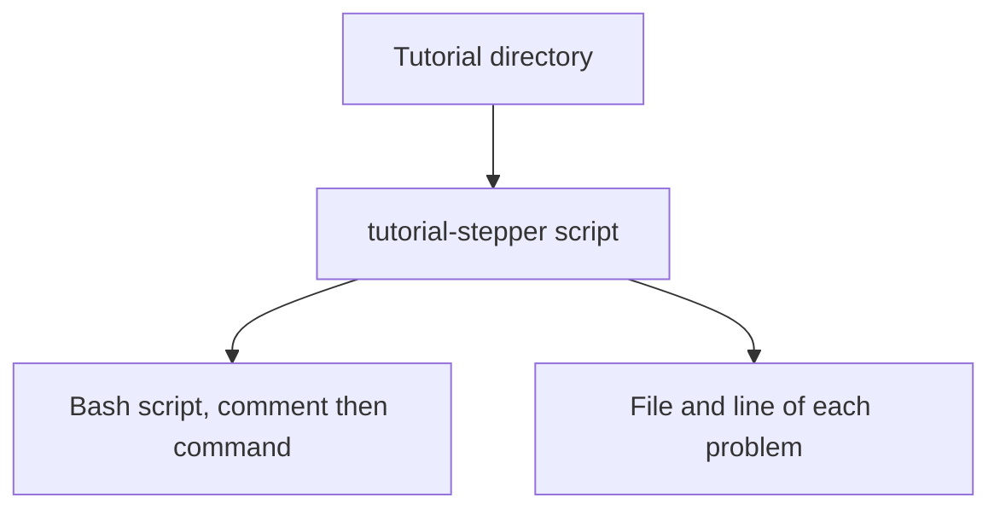

# Printing a tutorial as one script

A tutorial author runs `tutorial-stepper script` on a tutorial directory and reads one bash script. Every runnable command is there, in the order of the pages, and the comment before it names its page and its window. The author can read the script, diff it, or run it outside the stepper. The command itself runs nothing.

## Who it is for

The author, who wants the commands without playing the tutorial. [paolino/runmd](https://github.com/paolino/runmd) printed selected Markdown blocks from a separate recipe. `tutorial-stepper script` supersedes it: the pages of the tutorial are the source, and no recipe file is required.



## What is printed

A sound tutorial prints the script on standard output and exits 0. The first line is `#!/usr/bin/env bash`. Each runnable block then follows, with a blank line before its comment:

```bash
# welcome.md, window bob
echo hi
```

The page is the path listed in the index. The window is the `window` written on that fence. When the fence names no window, the comment says `window not named`. The window is never copied from the index, and nothing about the block is inferred from the command text.

A runnable block is a command, which is an attributed fence with no `mode`, or an observation, which is `mode=observe`. A block marked `mode=show` is left out. A fence with a language and no braces is an ordinary code block and is left out. The body of the fence is copied as written.

Blocks marked `if=` are all printed, in the order they appear on the page. This command does not choose a setting or a tested path. The set-up script named by the index is not part of the printed script. The tutorial's `shell` is not consulted: the printed script is bash, which is what `bash -n` checks.

The attributes themselves are specified in [Checking a tutorial's format](format.md).

## A broken tutorial

When the directory is not a sound tutorial, the command prints the same problems as `tutorial-stepper check`: one `FILE:LINE: message` line per problem, on standard error. Standard output is empty, and the command exits 1. A mistake in the command line exits 2.

## An example

`examples/mode` contains a shown block, an observation, and a command. Its script is the observation and then the command:

```bash
#!/usr/bin/env bash

# look.md, window bob
echo observed

# look.md, window bob
echo run
```
