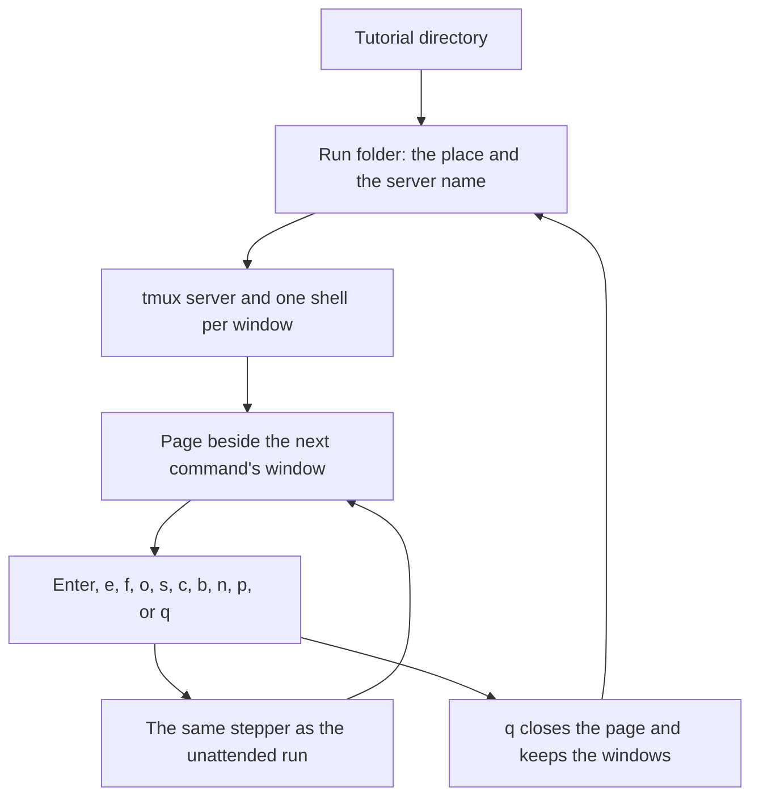
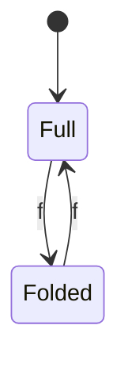
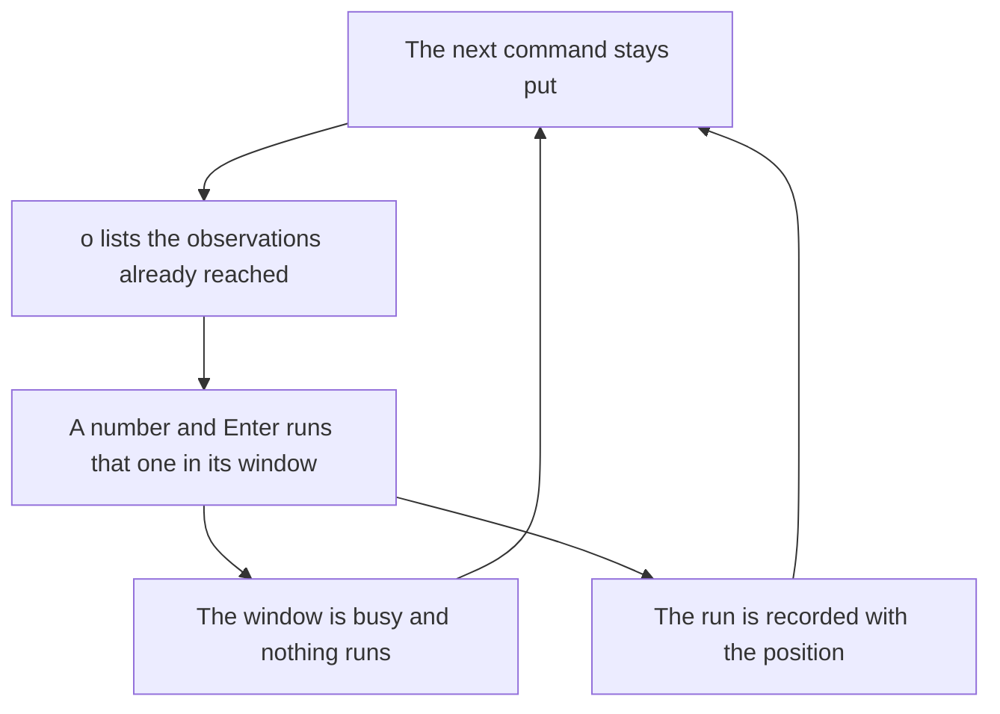
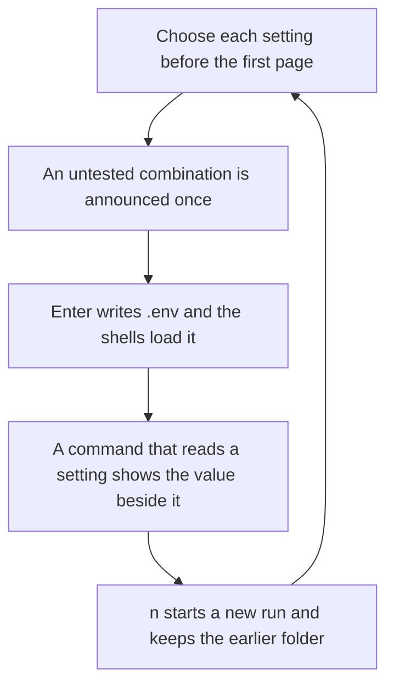

# Playing a tutorial in the terminal

A learner runs `tutorial-stepper play` on a tutorial directory. The stepper starts its own tmux server and attaches the learner's terminal to it. When the tutorial declares settings, the page offers them before any shell starts. One shell then starts per window the index declares. The page sits beside the window of the next command. Enter runs that command. `f` folds the explanations away, and `f` again brings them back. `o` lists the observations already reached, and choosing one runs it in its window without moving the next command. `q` closes the page and leaves the windows running, and a later `play` of the same tutorial comes back to the same place, explanations folded or not as the learner left them.

## Who it is for

The learner, at the keyboard, playing a tutorial in their own terminal. The unattended run is a different command: [Playing a tutorial unattended](play.md).



```bash
tutorial-stepper play examples/two-windows
```

The run folder is `$HOME/two-windows-run`. `--run DIR` uses `DIR` instead.

## The page and the keys

The page is the tutorial's Markdown, wrapped to the pane's width: headings, bold, inline code, code blocks, links and lists. The next command is marked. The page is beside that command's window. When the next command belongs to another window, the page moves beside that window.

Enter runs the marked command in its window. The window's prompt is the window's name followed by `$`, and the window shows the command and then its output. The command's end is noticed by the same stepper the unattended run uses. `s` skips the command and does not run it. `c`, while a command is running, sends Ctrl-C to that shell once; the stepper still waits until the shell's prompt says the command ended. `b` marks the previous command and leaves whatever that command already did. `n` and `p` turn the viewed page forward and back. They do not change which command Enter runs. Enter, `s` and `b` then show the page that holds the next command. `o` opens the list of observations already reached. `q` closes the page and keeps the windows.

`f` folds the explanations away. The page then shows only the commands and the observations on the viewed page, and each one is named with the window it runs in. A heading, a paragraph, a list, a block marked `mode=show`, and a code block that is not a command are left out. The next command stays marked. `f` again brings the explanations back. Enter, `e`, `o`, `s`, `c`, `b`, `n` and `p` do the same thing in both views, and the page stays folded until the learner unfolds it.



## An observation at any time

An observation runs where it appears, when the learner reaches it. From then on it stays on a list the learner can open without moving the next command. `o` replaces the page with that list. The list holds only the observations that stand before the next command, in the order they appear in the tutorial. Each row is a number, the window, and the first line of the command. Before any observation has been passed, the page says `No observation has been reached yet.` Skipping an observation reaches it. Going back so that it is the next command again takes it off the list. Turning the page does not add an observation that has not been passed, including one that is only visible on the page being viewed. The list is the same when the explanations are folded, and `f` does nothing while the list is open.

The learner types a number and presses Enter. That observation runs in its window. The next command stays where it was, and the page shows `The shell ran:` followed by the line that ran. Enter with no number, or `o` again, closes the list and runs nothing. A number that is not on the list is named. The page says `There is no observation N.` and the list stays. `q` still quits. Any other key does nothing while the list is open.

Before the observation is typed, the stepper asks whether that window's shell has reported the end of the command it was last given. When it has not, the page says `window NAME is busy` and nothing is typed, and nothing is recorded. The same is true of Enter when the next command is that observation. The face does not decide this by reading the screen.

Each run is appended to `.tutorial-stepper/observations.toml` in the run folder, one `[[observation]]` table, with the position at which it ran. That position is the page and the line of the next command at the moment the run starts, written `PAGE:LINE`. When the observation is itself the next command, that is its own page and line, and the position then advances as it does for any other block. When the tutorial is finished, the position is `done`. Running the same observation again writes another table, and the two positions differ. A run that did not happen, because the window was busy or the list was closed, writes nothing.

A run from the list whose status is not the one the block declares is shown and recorded, and the next command stays. Enter after that runs the next command. It does not retry the observation. An observation run where it appears keeps the retry the other blocks have: the page stays there, Enter retries, and `s` skips.

The face does not run every observation again at the end of the path. The unattended run does; that command is [Playing a tutorial unattended](play.md).



`e` places the marked block at that window's prompt and does not run it. Several lines arrive as one paste, and they stay there until the learner presses Enter in the window. The learner can change the line first. The page then shows `The shell ran:` followed by the line that ran. Ctrl-C at the prompt does not run the line and does not move the page; Enter does, even when the line has been cleared.

A block marked `mode=show` is shown and is not a command. A fence with no braces is an ordinary code block and is not run.

When a command or an observation exits with a status other than the one it declares, the page stays there. It names the page, the line, both statuses and the command that ran. Enter retries the block as written, `s` skips it, and `q` quits. Nothing after that block runs until the learner chooses. A later `play` shows the same choice and does not run the block again on its own.

After the last block, the page says the tutorial is done and the windows stay. `q` closes the page. `b` goes back to the last block.

## The run folder

The folder is `$HOME/<name>-run`, where `<name>` is the tutorial directory's name, unless `--run DIR` names another. It holds the window directories, the position, and the tmux server's name. The position is the page and the line of the next command, not a count of commands. The viewed page is remembered too, and turning pages does not change the next command. The same record says whether the explanations are folded. That choice is one for the whole run: turning the page keeps it, and a later `play` restores it.

A missing directory is created. An empty directory is used. A path that is a file is refused: the message says it is not a directory. A directory that already holds something, and is not this tutorial's run, is refused with the message that it is not empty, and nothing in it is changed. When `HOME` is missing or empty and `--run` was not given, the command exits 2 and says `the home directory is not set; pass --run DIR`. No server starts.

`q` writes the position, including the folded choice, and closes the page. The server keeps running. A second `play` of the same tutorial attaches to that server and marks the same command, folded or unfolded as it was. When the server is already gone, a new one starts in the same folder, with new shells, and the saved position is kept. The new shells do not resume the old shells' state. Files the commands wrote stay on disk.

When the saved command is no longer in the tutorial, the page says `The saved command is no longer in the tutorial. Starting at the beginning.` and starts there.

In a terminal, `play` attaches the learner's terminal to the server. When standard input is not a terminal, it prints the attach command and leaves the server running.

## Set-up

When the index names a set-up script, the page shows the script before the first command. Enter runs it. `q` quits without running it. A later `play` of the same run does not ask again.

The script is the same one the unattended run runs: bash, in the run folder, as the user who started `play`. The unattended run runs it only with `--run-setup`, and runs it before any shell starts. The face starts the shells first, so the page can show the script, and then runs it when the learner presses Enter. When the tutorial declares settings, that choice is made before those shells start.

As root, the script is refused before a server starts. The message is the same as for the unattended run: `play does not run the set-up script <script> as root`.

## The values in force

When the index declares settings, the page offers each one before the first page and before any shell starts. Each setting lists its allowed values, and the default is already selected. Up and `k`, down and `j` move between settings. Left and `h`, right and `l` change the selected value. Enter starts the tutorial. `q` quits: nothing is written and no shell starts.

Any combination is played, including one the author has not named as a tested path. While that combination is selected, the choice says `This combination is not a tested path.` The tutorial pages do not repeat it. When the tutorial names no tested path, or the chosen values are one of them, the choice says nothing about that.

Enter writes `.env` in the run folder, one `NAME=value` line per setting, in the order the index declares them. The shells load that file before their first command. The same file is the one [Playing a tutorial unattended](play.md) describes. A command whose text reads a setting shows those values beside it, as `NAME=value`, in that same order. A command that does not read a setting shows no such line.

A later `play` of a run that already chose shows the values in force. Enter continues at the saved place. `n` starts a new run: the earlier folder is moved aside, to a name ending in `.1`, then `.2`, and so on, and is not deleted. The new run starts at the original path and offers the choice again.


