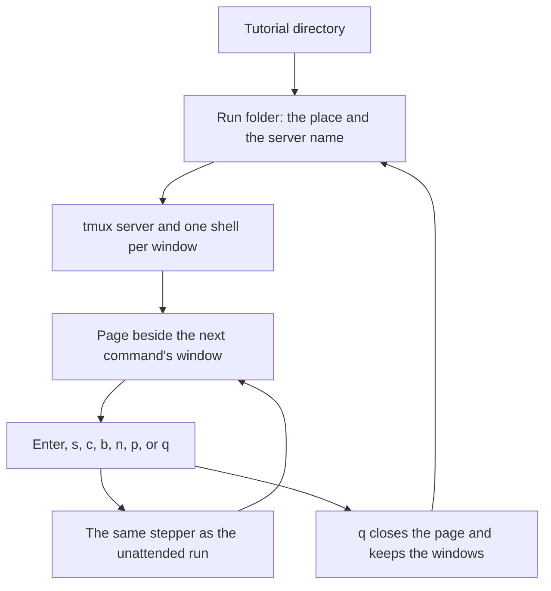

# Playing a tutorial in the terminal

A learner runs `tutorial-stepper play` on a tutorial directory. The stepper starts its own tmux server, one shell per window the index declares, and attaches the learner's terminal to it. The page sits beside the window of the next command. Enter runs that command. `q` closes the page and leaves the windows running, and a later `play` of the same tutorial comes back to the same place.

## Who it is for

The learner, at the keyboard, playing a tutorial in their own terminal. The unattended run is a different command: [Playing a tutorial unattended](play.md).



```bash
tutorial-stepper play examples/two-windows
```

The run folder is `$HOME/two-windows-run`. `--run DIR` uses `DIR` instead.

## The page and the keys

The page is the tutorial's Markdown, wrapped to the pane's width: headings, bold, inline code, code blocks, links and lists. The next command is marked. The page is beside that command's window. When the next command belongs to another window, the page moves beside that window.

Enter runs the marked command in its window. The window's prompt is the window's name followed by `$`, and the window shows the command and then its output. The command's end is noticed by the same stepper the unattended run uses. `s` skips the command and does not run it. `c`, while a command is running, sends Ctrl-C to that shell once; the stepper still waits until the shell's prompt says the command ended. `b` marks the previous command and leaves whatever that command already did. `n` and `p` turn the viewed page forward and back. They do not change which command Enter runs. Enter, `s` and `b` then show the page that holds the next command. `q` closes the page and keeps the windows.

A block marked `mode=show` is shown and is not a command. A fence with no braces is an ordinary code block and is not run. An observation runs where it appears, when the learner reaches it. The face does not run observations again at the end.

When a command or an observation exits with a status other than the one it declares, the page stays there. It names the page, the line, both statuses and the block. Enter retries it, `s` skips it, and `q` quits. Nothing after that block runs until the learner chooses. A later `play` shows the same choice and does not run the block again on its own.

After the last block, the page says the tutorial is done and the windows stay. `q` closes the page. `b` goes back to the last block.

## The run folder

The folder is `$HOME/<name>-run`, where `<name>` is the tutorial directory's name, unless `--run DIR` names another. It holds the window directories, the position, and the tmux server's name. The position is the page and the line of the next command, not a count of commands. The viewed page is remembered too, and turning pages does not change the next command.

A missing directory is created. An empty directory is used. A path that is a file is refused: the message says it is not a directory. A directory that already holds something, and is not this tutorial's run, is refused with the message that it is not empty, and nothing in it is changed. When `HOME` is missing or empty and `--run` was not given, the command exits 2 and says `the home directory is not set; pass --run DIR`. No server starts.

`q` writes the position and closes the page. The server keeps running. A second `play` of the same tutorial attaches to that server and marks the same command. When the server is already gone, a new one starts in the same folder, with new shells, and the saved position is kept. The new shells do not resume the old shells' state. Files the commands wrote stay on disk.

When the saved command is no longer in the tutorial, the page says `The saved command is no longer in the tutorial. Starting at the beginning.` and starts there.

In a terminal, `play` attaches the learner's terminal to the server. When standard input is not a terminal, it prints the attach command and leaves the server running.

## Set-up

When the index names a set-up script, the page shows the script before the first command. Enter runs it. `q` quits without running it. A later `play` of the same run does not ask again.

The script is the same one the unattended run runs: bash, in the run folder, as the user who started `play`. The unattended run runs it only with `--run-setup`, and runs it before any shell starts. The face starts the shells first, so the page can show the script, and then runs it when the learner presses Enter.

As root, the script is refused before a server starts. The message is the same as for the unattended run: `play does not run the set-up script <script> as root`.

## The values in force

The face plays the tutorial's default values once. It does not ask the learner to choose. When the index declares settings, the page shows them as `NAME=value`, in the order the index declares them. The shells load those values from `.env` before the first command. That file is the one [Playing a tutorial unattended](play.md) describes. When the tutorial declares tested paths and the defaults are not one of them, the page says once: `This combination is not a tested path.`
