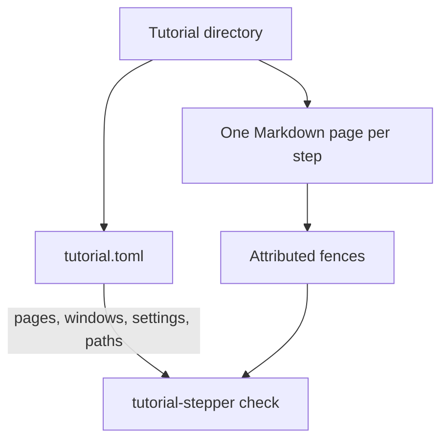

# Feature Specification: Check a tutorial's format

**Feature Branch**: `feat/5-check`
**Created**: 2026-10-22
**Status**: The index file is `tutorial.toml`
**Input**: Issue 5, "The tutorial-stepper binary checks a tutorial's format"

## User Scenarios & Testing

### User Story 1 — An author checks a tutorial before anyone plays it (Priority: P1)

A tutorial author keeps a tutorial as one index file plus one plain Markdown page per step. They run `tutorial-stepper check` on that directory. When the tutorial follows version 0 of the format, the command confirms how many pages and how many commands it found, and exits 0. When it does not, the command prints one line per problem, `FILE:LINE: message`, and exits non-zero. Nothing is executed. The same command is what continuous integration runs on the example tutorials.

**Why this priority**: Every later command reads this format. A tutorial that cannot be checked cannot be played, printed, or rendered.

**Independent Test**: `tutorial-stepper check` exits 0 on every tutorial under `examples/`, and exits non-zero with `FILE:LINE: message` on every tutorial under `examples/invalid/`.

**Acceptance Scenarios**:

1. **Given** a tutorial whose pages and fence attributes follow version 0, **When** the author runs `tutorial-stepper check` on its directory, **Then** the command prints a confirmation that includes the number of pages and the number of commands, and exits 0.
2. **Given** a code fence whose info string tries to carry attributes as a JSON object, as bare words, or as Pandoc's `{.lang …}` form, **When** the author runs the check, **Then** the command prints that file and line and exits non-zero.
3. **Given** a fence that uses an attribute other than `window`, `status`, `mode`, or `if`, **When** the author runs the check, **Then** the command names the unknown attribute with its file and line and exits non-zero.
4. **Given** a block whose `window` is not declared in the index, a page the index does not list, an index entry whose page file is missing, or an `if` that names a setting or a value the index does not declare, **When** the author runs the check, **Then** each problem is printed as `FILE:LINE: message` and the command exits non-zero.
5. **Given** an index key the format does not define, a setting whose default is not one of its values, a tested path that misses a setting or names an unknown one or gives a value that is not allowed, or two windows, settings, or paths with the same name, **When** the author runs the check, **Then** each problem is printed as `FILE:LINE: message` and the command exits non-zero.

### Edge Cases

- A fence with a language and no braces is an ordinary code block. It is not a command, and it is not an error.
- A fence whose info string opens a brace and never closes it is a malformed attribute list, reported at that fence's line.
- Attribute values are single words: no spaces, no quotes. `SIGNING:external` is one word. `{"window":"bob"}` is not an attribute list.
- Several problems in one tutorial are all printed. The command does not stop at the first.
- The path in each message is the tutorial directory the author named, joined with the page path inside it, so the line can be opened from the directory they ran the command in.
- A directory that is not a tutorial (the index file is absent) is an error, reported at line 1 of that directory.

## Requirements

### Functional Requirements

- The repository builds one Rust binary, `tutorial-stepper`, with a Nix flake. `tutorial-stepper check DIR` reads the tutorial in `DIR` and does not run any of its commands.
- Version 0 of the format is written in `docs/format.md`: the index file, the pages, and every block attribute (`window`, `status`, `mode`, `if`), each with an example.
- Block attributes are read only from a code fence info string of the form ``lang { key=value }``, as in `` ```bash { window=bob status=19 } ``. The language is one word. Inside the braces, `key=value` pairs are separated by whitespace. The keys are `window`, `status`, `mode`, and `if`.
- `window` names a window the index declares. `status` is the exit status the block is expected to end with, written as a non-negative integer. `mode` is `show` (the block is only shown) or `observe` (the block is an observation). `if` is `NAME:value`, and `NAME` is a setting the index declares. A block with no `mode` is a command to run. A block with no `status` is expected to end at status 0. A block with no `if` is shared by every setting.
- Any other spelling of attributes is an error at that fence's line. The rejected spellings are a JSON object (`{"window":"bob"}`), bare words after the language (`bash window=bob`), and Pandoc's braced class form (`{.bash …}`).
- The index file is `tutorial.toml` at the tutorial root. Its contents are recorded under "The index file" below. `shell`, `setup`, and `[[setting]]` are optional. `pages` and at least one `[[window]]` are required. A key the format does not define is an error at that key's line.
- `check` reports, with file and line: a page listed but missing; a Markdown page in the directory that is not listed; a block whose `window` names no declared window; an `if` whose setting or value is not declared; a setting whose `default` is not among its `values`; a path that misses a setting, names an undeclared one, or gives a value that is not allowed; two windows, settings, or paths with the same name. `needs` and `setup` are parsed and their shape is checked. Nothing is run or looked up.
- A command is an attributed fence with no `mode`. A `show` block and an `observe` block are not commands. The confirmation is one line, `<n> pages, <m> commands`, with the singular used when the count is one, and it is the only line on standard output. Problems go to standard error.
- The check exits 0 for every tutorial under `examples/` and exits non-zero for every tutorial under `examples/invalid/`. There is one invalid tutorial per error kind: an unknown attribute, a malformed attribute spelling, a block whose window is not declared, a page the index does not list, an index that names a missing page, and an `if` that names an undeclared setting. The further index problems above have an invalid tutorial each as well.
- Continuous integration runs on the organisation's NixOS runners. A job named Build Gate runs first and builds every derivation the later jobs run. The later jobs are the format check (rustfmt), clippy with warnings as errors, and the tests. Formatting, clippy, and the tests are flake checks, so `nix flake check` is the same gate locally and in continuous integration.
- release-please opens release pull requests for the Rust crate. The token that opens them is minted from the organisation's continuous-integration app, so the pull request and the tag actually trigger the workflows. A release attaches the Linux x86_64 binary and a checksum file.
- `tutorial-stepper --version` prints `tutorial-stepper <version> (commit <commit>)`. `--help`, with no command and with `check`, fits one screen and describes the command.

### Key Entities

- **Tutorial**: a directory containing one index file and the Markdown pages it lists.
- **Page**: one CommonMark file. Its commands are fenced code blocks. Explanations around them are ordinary Markdown.
- **Block attributes**: the `key=value` pairs in a fence's info string. Nothing about a block is inferred from the command text.
- **Index file**: `tutorial.toml`. It declares the pages, the windows, the settings, and the tested paths. The check uses the page list, the window names, the setting names and values, and the paths. It checks the shape of `shell`, `setup`, and `needs`, and does not run them.

## Success Criteria

- An author can tell a sound tutorial from a broken one by the exit status of one command, and can open every problem at the line the message names.
- Each of the six error kinds has an example tutorial that fails the check, and each valid example passes it.
- A reader of `docs/format.md` can write a tutorial that the check accepts, including one example of each attribute, without reading the source.
- The Linux x86_64 binary is what a release attaches, together with its checksum. Binaries for other platforms are out of scope for this issue.

## The index file

The constitution says a tutorial is one index file plus one CommonMark file per page. It leaves the file's name and syntax to the operator. The operator chose `tutorial.toml`.



| Candidate | Why it was considered | Decision |
| --- | --- | --- |
| `tutorial.toml` | The index is data, not a page. A word stays a word: `yes` is not a boolean and `1.10` is not a number. | Chosen. |
| `tutorial.yaml` | Documentation tools already use YAML. | Rejected. YAML retypes `yes`, `no`, and version-shaped numbers, and this file is full of setting values and versions. |
| `index.md` | A learner could read the index as a page. | Rejected. The index would then be a Markdown page, and a page the index does not list would have to say whether the index counts. The front matter is YAML, with the same typing surprises. |

Top-level keys come before every table header. A key written after `[[window]]` would belong to that window.

```toml
shell = "bash"
setup = "setup.sh"
pages = ["welcome.md", "build.md"]

[[window]]
name = "alice"
folder = "alice"
needs = ["singular >= 0.14.0", "jq"]

[[window]]
name = "bob"
folder = "bob"
needs = ["singular >= 0.14.0"]

[[setting]]
name = "SIGNING"
default = "external"
values = ["external", "internal"]

[[path]]
name = "external"
values = { SIGNING = "external" }

[[path]]
name = "internal"
values = { SIGNING = "internal" }
```

`shell` is `bash` or `zsh`. When it is absent, the shell is bash. `setup` is a relative path to the set-up script. Each window has a `folder`, relative to the run folder, and `needs`: each entry is a program name, or a program name, `>=`, and a version. A setting has a name, a default, and the values allowed; the default is one of those values. A path gives one allowed value for every setting. `check` does not run `setup` and does not look up what `needs` names.

## Assumptions

- Version 0 is the first published format. Later issues add commands; they do not get a second attribute spelling.
- The examples are small and generic. They mention no particular product.
- "A release carries the Linux x86_64 binary" is this issue's cut of the constitution's three platforms. The other two platforms belong to a later issue, not to a change of principle.
- The confirmation line is human-readable. No machine-readable report is required.

## Out of scope

- Running, printing, or rendering a tutorial.
- Binaries for Linux arm64 and macOS, and a documentation site.
