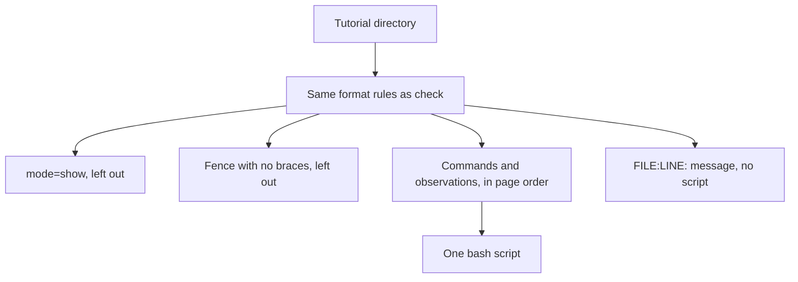

# Feature Specification: Print a tutorial's commands as one script

**Feature Branch**: `feat/6-script`
**Created**: 2026-10-22
**Status**: Specified
**Input**: Issue 6, "Print a tutorial's commands as one script"

## User Scenarios & Testing

### User Story 1 — An author prints the runnable commands (Priority: P1)

A tutorial author runs `tutorial-stepper script DIR` and reads one bash script. Every runnable command appears in the tutorial's order. A comment on the line before each command names that command's page and its window. The author can read the script, diff it, or run it outside the stepper. `paolino/runmd`, which printed selected Markdown blocks from a separate recipe, is superseded by this command.

**Why this priority**: This is the whole issue. Printing is how an author inspects the commands without playing the tutorial, and it is the replacement for `paolino/runmd`.

**Independent Test**: `tutorial-stepper script` on every tutorial under `examples/` (not under `examples/invalid/`) prints a script that `bash -n` accepts, and the comments name each command's page and window. `mode=show` blocks are absent. Observations appear where they stand in the page.

**Acceptance Scenarios**:

1. **Given** a sound tutorial, **When** the author runs `tutorial-stepper script` on its directory, **Then** standard output is one bash script whose first line is `#!/usr/bin/env bash`, and the command exits 0. Each runnable command follows, in order, and the line before it is a comment naming its page and its window.
2. **Given** a block marked `mode=show`, **When** the author prints the script, **Then** that block does not appear.
3. **Given** a block marked `mode=observe`, **When** the author prints the script, **Then** that observation appears where it stands in the page, with the same kind of comment as a command.
4. **Given** a fence with a language and no braces, **When** the author prints the script, **Then** that fence does not appear. It is an ordinary code block, not a command.
5. **Given** a tutorial that `tutorial-stepper check` rejects, **When** the author runs `tutorial-stepper script` on it, **Then** standard output is empty, standard error is the same `FILE:LINE: message` lines `check` prints, and the command exits 1.
6. **Given** every sound tutorial under `examples/`, **When** its script is passed to `bash -n`, **Then** `bash -n` exits 0.

### Edge Cases

- A command is an attributed fence with no `mode`. An observation is an attributed fence with `mode=observe`. Both are runnable. A `mode=show` fence is not.
- The comment is `# <page>, window <name>`. `<page>` is the path the index lists. `<name>` is the fence's `window`. When the fence names no window, the comment is `# <page>, window not named`. The window is never copied from the index.
- Order is the index's page order, and within a page the order of the fences. A block marked `if=` is printed with the others. Choosing one tested path is a later command.
- The fence body is copied as written. A body that does not end with a newline is given one, so the next comment starts on its own line.
- A directory that is not a tutorial is the same error `check` reports. No script is printed.
- The command does not run the script, does not run the set-up script, and does not look up `needs`.

## Requirements

### Functional Requirements

- `tutorial-stepper script DIR` reads the tutorial in `DIR` with the same format rules as `tutorial-stepper check`. It runs nothing.
- On a sound tutorial the only standard output is the script, and the exit status is 0. On a tutorial `check` would reject, standard output is empty, standard error matches `check`, and the exit status is 1. A mistake in the command line exits 2.
- The script starts with `#!/usr/bin/env bash`. The tutorial's own `shell` is not consulted: this command prints bash, which is what `bash -n` checks.
- Runnable blocks are attributed fences whose `mode` is absent or `observe`, in index page order, then fence order. `mode=show` is left out. A fence without braces is left out.
- The comment before each block names its page and its window, in the form above. The body follows, unchanged apart from a final newline when the fence omitted one.
- Blocks marked `if=` are all printed. `--path` is out of scope.
- The set-up script named by `setup` is not part of the printed script. It is a file the learner agrees to run, not a command on a page.
- `tutorial-stepper script --help` describes the command, says how problems are printed, and gives an example. The overview names `script` and says how to get help on it.
- The command's reference is `docs/script.md`. The README says `paolino/runmd` is superseded by `tutorial-stepper script`.
- Every sound tutorial under `examples/` has a script that `bash -n` accepts. The tutorials under `examples/invalid/` print no script.

### Key Entities

- **Runnable block**: an attributed fence that is a command or an observation. Its page, its window, and its body are what the script prints.
- **Script**: one bash text. Comments name the source of each block. The bodies are the commands.

## Success Criteria

- An author can print a sound tutorial as one bash script and see, in a comment, which page and which window each command came from.
- A block that is only shown is absent, and an observation is present where the page has it.
- A broken tutorial prints the same problems as `check` and prints no script.
- `bash -n` accepts the script of every sound example.
- A reader of `docs/script.md` can say what the command prints, what it leaves out, and that it does not run the tutorial, without reading the source.

## The script



`examples/one-window` prints:

```bash
#!/usr/bin/env bash

# welcome.md, window bob
echo hi
```

`examples/mode` prints the observation and then the command. The block marked `mode=show` is absent. `examples/if` prints both setting branches, external then internal, because this command does not choose a path.

## Assumptions

- "One bash script" means bash even when the tutorial declares `shell = "zsh"`. The windows' shell belongs to playing the tutorial.
- Issue 6's "every example under `examples/`" is read as every sound example. The invalid examples are rejected, so they have no script to check. The verification command in the brief is the same reading.
- The expected exit status on a block is not written into the script. The script is the commands, not the unattended run.
- Nothing in the script sets shell options. Running it is the author's choice, and this command does not do that.

## Out of scope

- Running the script, including the set-up script and the needs check.
- Settings and tested paths. A later issue adds `--path`.
- Playing a tutorial, in bash or in zsh.
