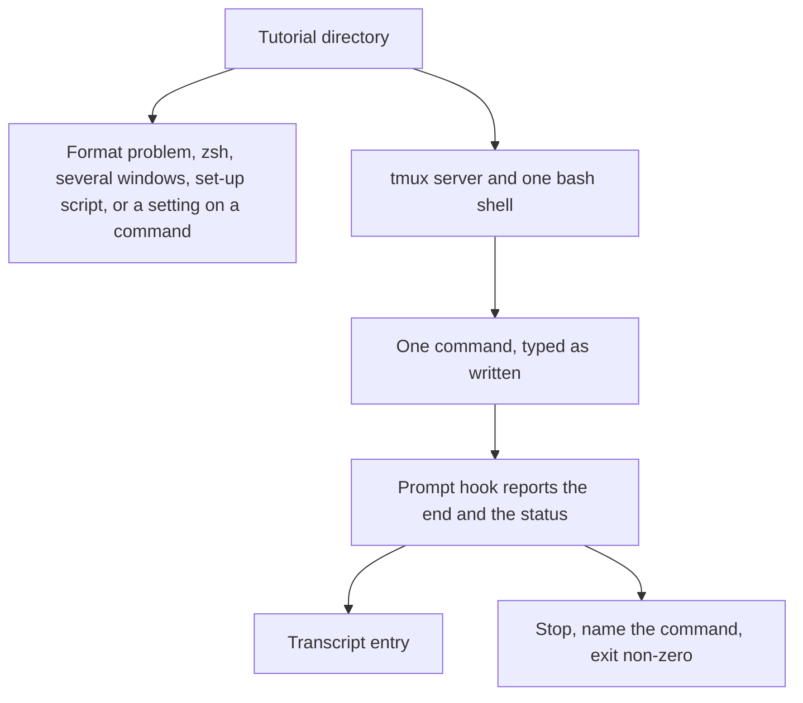

# Feature Specification: Play a one-window tutorial unattended

**Feature Branch**: `feat/7-play-auto`
**Created**: 2026-10-22
**Status**: Specified
**Input**: Issue 7, "Play a one-window tutorial unattended"

## User Scenarios & Testing

### User Story 1 — An author plays a one-window bash tutorial (Priority: P1)

A tutorial author runs `tutorial-stepper play --auto DIR --transcript FILE` on a one-window bash tutorial. The stepper plays each command, in order, in a bash shell of its own. The run stops at the first command whose exit status is not the one the block declares, and the process exits non-zero. FILE holds every command that ran, with the page and the block it came from, the command text, the output, the status, and the start and end time.

**Why this priority**: This is the whole issue. Unattended play is how a tutorial becomes a test.

**Independent Test**: `tutorial-stepper play --auto` on `examples/one-window` exits 0 and the transcript records `echo hi`, its output, status 0, and two times. The same command on `examples/status` exits non-zero, names `echo not yet`, and records that command. After either run, the stepper's tmux server is gone.

**Acceptance Scenarios**:

1. **Given** a sound one-window bash tutorial, **When** the author runs `tutorial-stepper play --auto` on it with `--transcript`, **Then** each command runs in order, the process exits 0, and standard output is one confirmation of how many commands played.
2. **Given** that run, **When** it ends, whether it passed or failed, **Then** the tmux server the stepper started is gone.
3. **Given** a command that sleeps 120 seconds and declares no status, **When** the author plays the tutorial, **Then** the run waits until that command ends, the transcript's times span that wait, and the command passes. No deadline inside the stepper decides that the command ended.
4. **Given** a block that declares `status=19`, **When** its command exits 19, **Then** the command passes. **When** its command exits 0, **Then** the run stops, the process exits non-zero, and the message names that command and both statuses.
5. **Given** a block that declares no status, **When** its command exits 0, **Then** the command passes. **When** its command exits with anything else, **Then** the run stops as in the previous scenario.
6. **Given** a command written over several lines, including a line that continues with `\`, **When** the author plays it, **Then** the shell runs it as one command and the transcript has one entry for it.
7. **Given** a block marked `mode=show` or `mode=observe`, or a fence with no braces, **When** the author plays the tutorial, **Then** that block is not run and does not appear in the transcript.
8. **Given** a tutorial `tutorial-stepper check` rejects, **When** the author plays it, **Then** standard error matches `check`, standard output is empty, the transcript file is not created, and no tmux server is started.
9. **Given** the conformance examples, **When** continuous integration runs, **Then** each example is played and ends with its expected outcome, including the examples that must fail.

### Edge Cases

- A command is an attributed fence with no `mode`. The expected status is `status` when the fence sets it, and 0 when it does not.
- The fence body is one command. It is typed as written. The status is the status the shell reports when its prompt returns, including when the body is several lines or several simple commands.
- The shell starts in the window's folder. That folder is created for the run and removed when the run ends. The tutorial's own files are not the shell's working directory.
- A tutorial that declares `shell = "zsh"`, more than one window, a set-up script, or a command marked `if=` is not played. The message names the reason. Nothing is typed, and the transcript file is not created.
- `tmux` and `bash` are taken from `PATH`. When either is missing, the process exits non-zero, names the missing program, and starts no server.
- A mistake in the command line exits 2. `--auto` and `--transcript` are both required.

## Requirements

### Functional Requirements

- `tutorial-stepper play --auto DIR --transcript FILE` reads `DIR` with the same format rules as `tutorial-stepper check`.
- The stepper starts its own tmux server. The server uses its own socket name and does not read a tmux configuration file. One bash shell runs on that server and loads the stepper's prompt hook. The hook reports each command's end and exit status. The stepper does not decide that a command ended by a deadline or by reading the output.
- The shell is bash. The tutorial's `shell` is bash when the key is absent. `zsh` is refused.
- Exactly one window is played. Every command runs in that window's shell, whether or not the fence names the window. A second window is refused.
- A declared set-up script is refused, naming the script. A command marked `if=` is refused, naming the block. Choosing a setting, running the set-up script, and playing several windows are later commands.
- Commands run in index page order, then fence order. `mode=show`, `mode=observe`, and a fence without braces are left out.
- The first command whose reported status differs from the declared one stops the run. Later commands are not run. The process exits 1. Standard error names the page, the line, the command, the status the shell reported, and the status the block declared. Standard output is empty.
- A run that plays every command exits 0. Standard output is `1 command played` or `N commands played`. Standard error is empty.
- The transcript is written only when a shell was started. It is written when the run ends, passed or failed, and it holds one entry per command that ran. Its format is specified below and in `docs/play.md`.
- A format problem is the same `FILE:LINE: message` lines as `check`, on standard error, exit 1, with no transcript and no server.
- `tutorial-stepper play --help` describes the command, both required options, how a failure is printed, and gives an example. The overview names `play` and says how to get help on it.
- The conformance examples cover a passing command, a command whose declared status matches, a command whose declared status does not match, a command continued over several lines, a command that sleeps 120 seconds, and a tutorial `check` rejects. Those plays run in continuous integration.

### Key Entities

- **Command**: one attributed fence with no `mode`. It has a page, a line, a body, and an expected status.
- **Transcript**: the file named by `--transcript`. One entry per command that ran.
- **Prompt hook**: the bash hook the stepper's shell loads. It reports the end of a command and the exit status. The stepper waits on that report.

## Success Criteria

- An author can play `examples/one-window` unattended and read, in the transcript, the command, the output `hi`, status 0, and the start and end time.
- An author can play `examples/status` and see a non-zero exit that names `echo not yet`, status 0, and the declared status 19.
- A command that sleeps 120 seconds is waited out. The run does not end early.
- A continued command is one transcript entry.
- After a passing run and after a failing run, no tmux server of the stepper's is left.
- A reader of `docs/play.md` can say what the command runs, what it refuses, and what a transcript entry contains, without reading the source.

## The transcript



A passing command is one table:

```toml
[[command]]
page = "welcome.md"
block = 1
command = "echo hi\n"
status = 0
start = "2026-10-22T21:07:53.123456789Z"
end = "2026-10-22T21:07:53.456789012Z"
output = "hi\n"
```

`page` is the path listed in the index. `block` is the 1-based line of the opening fence. `command` is the fence body as written. `status` is the exit status the prompt hook reported, from 0 to 255. `start` and `end` are UTC times, written as `YYYY-MM-DDTHH:MM:SS.NNNNNNNNNZ`, taken just before the command is typed and when the hook reports the end. `output` is the text the command wrote. The prompt is not part of it. A command that writes nothing has an empty output. Newlines in `command` and `output` are kept.

The tables are in the order the commands ran. A run that plays no command writes an empty file. No other keys are written.

## Assumptions

- Issue 7 plays commands. An observation (`mode=observe`) is not a command. Playing observations, and playing them again at the end, belongs to a later issue. A shown block is not a command either.
- A fence body is one shell command even when it contains more than one simple command. The status is the status reported when the prompt returns.
- The run folder is temporary. The window's folder is created inside it. Both are removed when the run ends. The transcript is the file the author named, and it is not inside that temporary folder.
- Refusing zsh, a second window, a set-up script, and a command marked `if=` is the behaviour of this command. Later issues add those runs. This command does not grow a flag for them.
- `examples/status` is a sound tutorial whose play must fail: the block declares `status=19` and `echo not yet` exits 0. New examples cover a matching status 19, a continued command, and a 120 second sleep.
- The stepper finds `tmux` and `bash` on `PATH` at run time. It does not bundle them.

## Out of scope

- Several windows, the set-up script, and the needs check.
- zsh.
- Settings, tested paths, and `--path`.
- Observations in the unattended run, including running them again at the end.
- The interactive face.
