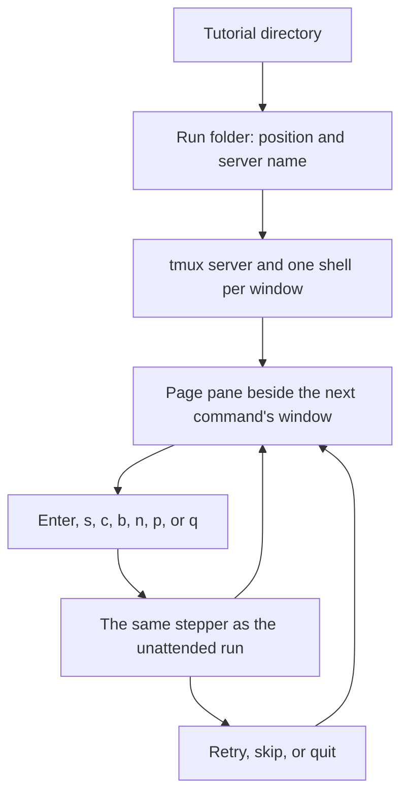

# Feature Specification: Play a tutorial page by page in the terminal

**Feature Branch**: `feat/12-terminal-face`
**Created**: 2026-10-23
**Status**: Specified
**Input**: Issue 12, "Play a tutorial page by page in the terminal"

## User Scenarios & Testing

### User Story 1 — A learner plays the page beside the acting window (Priority: P1)

A learner runs `tutorial-stepper play DIR`. The stepper's tmux server comes up with one shell per window the index declares, and the learner's terminal attaches to it. The page is a pane beside the window of the next command. The page is the tutorial's Markdown, wrapped to the pane's width: headings, bold, inline code, code blocks, links and lists. The next command is marked. Enter runs it in that window, through the same stepper the unattended run uses, and the page then marks the following command. When that command belongs to another window, the page moves beside that window.

**Why this priority**: This is the whole issue. The terminal face is how a learner plays a tutorial.

**Independent Test**: In a detached tmux session, `tutorial-stepper play examples/two-windows` shows the page beside the first window. Enter runs `pwd` there. The page then sits beside the other window and marks that window's command. No person sits at the keyboard: the test sends the keys.

**Acceptance Scenarios**:

1. **Given** a tutorial whose page has a heading, bold text, inline code, a code block, a link and a list, **When** the learner runs `tutorial-stepper play` on it, **Then** the page pane shows each of those, wrapped so no line is wider than the pane, and the next command is marked.
2. **Given** the page is showing, **When** the learner presses Enter, **Then** the marked command runs in its window and the page marks the next command. **When** the learner presses `s`, **Then** that command does not run and the page marks the next one. **When** a command is running and the learner presses `c`, **Then** the shell receives Ctrl-C. **When** the learner presses `b`, **Then** the page marks the previous command and the files that command created are still there. **When** the learner presses `n` or `p`, **Then** the page turns forward or back and the next command does not change. **When** the learner presses `q`, **Then** the page pane closes and the windows keep running.
3. **Given** the next command names another window, **When** the page is drawn, **Then** the page pane is beside that window, not beside the previous one.
4. **Given** a command exits with a status other than the one it declares, **When** the shell reports it, **Then** the page shows the page, the line, both statuses and the command, and Enter retries it, `s` skips it, and `q` quits. The run does not continue past that command on its own.
5. **Given** the learner pressed `q` after a command, **When** the learner runs `tutorial-stepper play` on the same tutorial again, **Then** the same windows are still there and the page marks the same next command.
6. **Given** the conformance examples, **When** the end-to-end test runs, **Then** it drives Enter, `s`, `c`, `b`, `n`, `p`, `q` and a second `play` through tmux, with no person at a terminal.

### Edge Cases

- The run folder is `$HOME/<name>-run`, where `<name>` is the tutorial directory's name. `--run DIR` uses that directory instead. Both are written on the page that describes the face. The folder holds the window directories, the position (the page and the line of the next command), and the tmux server's name.
- A missing home directory, and no `--run`, is refused before a server starts. The message says to pass `--run`.
- `--run DIR` may already be the folder of this tutorial. A directory that holds something else is refused, and nothing in it is changed. A `DIR` that is a file is refused.
- `q` leaves the server running. A later `play` attaches to it. When that server is already gone, a new one starts in the same folder and the saved position is kept. The shells are new; the stepper does not restore shell state.
- `--auto` is unchanged. It still requires `--transcript`, still plays every tested path when `--path` is absent, and still removes its server at the end. `--transcript`, `--path` and `--run-setup` without `--auto` are refused. The message names the option and `--auto`.
- The face plays one run, with the tutorial's default setting values. It does not ask the learner to choose. When the tutorial declares settings, the page shows the values in force, and says once when that combination is not a tested path.
- An observation runs where it appears, when the learner reaches it, through the same stepper. The face does not run observations again at the end, and it has no list to run one on demand. A block marked `mode=show` is shown and is not a command. A fence without braces is an ordinary code block.
- A set-up script is shown before the first command and runs only when the learner presses Enter. `q` quits without running it. It is not asked again on a later `play` of the same run. As root, the script is refused before a server starts, with the same message as `--auto`.
- A format problem is the same `FILE:LINE: message` lines as `check`, and no server starts. A missing program named in `needs` is named before a server starts.
- Push, folding the explanations away, and choosing settings are later issues. The face has no `e` key.

## Requirements

### Functional Requirements

- `tutorial-stepper play DIR` attaches the learner's terminal to the stepper's tmux server. One shell per declared window runs there, the shell the index names, with the same prompt hook as `--auto`.
- The page is rendered with a Markdown parser and wrapped to the pane's width. The next command is marked. Enter, `s`, `c`, `b`, `n`, `p` and `q` do what the story says.
- Sending a command and noticing that it ended happen in the same functions `--auto` uses. The face does not keep a second copy of either.
- A status other than the declared one stops on the page with retry, skip and quit. Nothing after that command runs until the learner chooses.
- The position and the server's name are stored in the run folder. `q` keeps the windows. A second `play` of the same tutorial returns to them.
- The end-to-end test starts the face in a detached tmux session and sends the keys with tmux. It does not need a human terminal.
- `tutorial-stepper play --help` describes the face first, then `--auto`, names every key, names the default run folder and `--run`, and gives an example of each way to run it. The overview stays one screen. A mistake in the command line exits 2.

### Key Entities

- **Page pane**: the pane that shows the rendered page, beside the window of the next command.
- **Position**: the page and the line of the next command, kept in the run folder. Turning the page does not change it.
- **Run folder**: `$HOME/<name>-run`, or the directory `--run` names. It outlives `q`.

## Success Criteria

- A learner can play `examples/two-windows`, see the page move from the first window to the second after Enter, press `q`, and run the same command again at the command where they stopped.
- A command whose status does not match stays on the page until the learner retries, skips or quits.
- `tutorial-stepper play --auto` still plays the conformance examples the way it does today.
- A reader of the terminal-face page can name the keys, the default run folder, and what `q` leaves behind, without reading the source.

