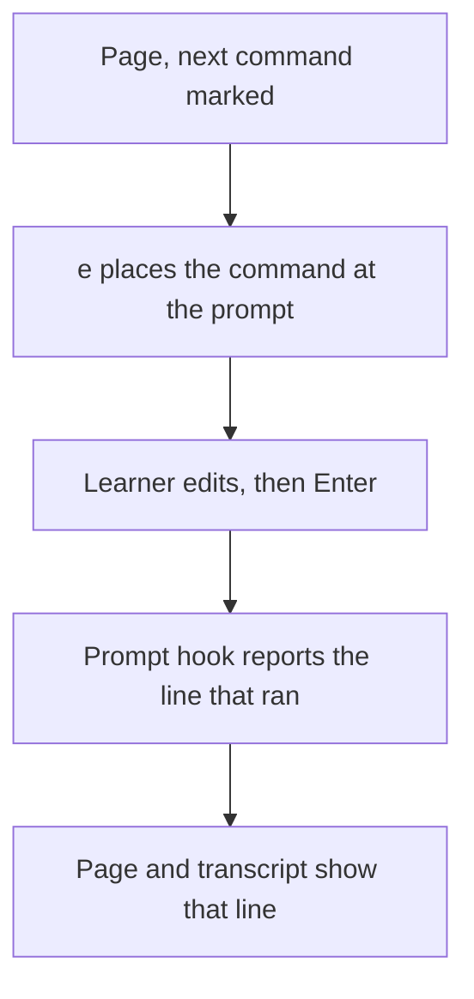

# Feature Specification: Push a command to edit it before it runs

**Feature Branch**: `feat/13-push`
**Created**: 2026-10-23
**Status**: Specified
**Input**: Issue 13, "Push a command to edit it before it runs"

## User Scenarios & Testing

### User Story 1 — Edit a command at the prompt, and keep what ran (Priority: P1)

A learner playing `tutorial-stepper play DIR` presses `e`. The marked command is placed at the prompt of its window and does not run. A command of several lines arrives as one paste. The learner edits it and presses Enter in that window. The page and the transcript then show the command that ran, including the edit, rather than the text on the page.

**Why this priority**: This is the whole issue. Enter already runs the command as written. Push is how the learner changes it first.

**Independent Test**: In a detached tmux session, `tutorial-stepper play` shows the page. `e` places a command of several lines at the prompt and the command's output does not appear. The test then changes the line and presses Enter. The page shows the changed line. No person sits at the keyboard: the test sends the keys.

**Acceptance Scenarios**:

1. **Given** the next command is several lines, **When** the learner presses `e`, **Then** those lines sit at the prompt as one paste, in bash and in zsh, and the command does not run until Enter.
2. **Given** the command is sitting at the prompt, **When** the learner edits it and presses Enter, **Then** the shell runs the edited line. The page shows that line. The transcript's command is that line, for a command the stepper typed as well as for one the learner edited.
3. **Given** the conformance examples, **When** the end-to-end test runs, **Then** it edits a pushed command through tmux and checks the recorded text. It does not need a human terminal.

### Edge Cases

- `e` pushes the marked command or observation. It does nothing after the last block, and nothing while the page is waiting on a status other than the one the block declares. Enter still retries that block as written.
- The window is where the learner edits. Enter there runs the line. Ctrl-C there interrupts a command that has started. Clearing the line and pressing Enter runs an empty command, and that is what the record holds.
- The tutorial's source is not changed.
- `--auto` still types each command and presses Enter. Its transcript command is the line the shell ran. For a command the stepper typed and nobody edited, that line is the fence body.
- Bash and zsh report the same line for the same typed command. A tutorial that plays under both shells keeps one transcript.

## Requirements

### Functional Requirements

- `e` places the marked block at its window's prompt and does not press Enter. Several lines are one paste. Bash 5.1 or newer and zsh both leave the paste unrun until Enter.
- The prompt hook reports the line that was accepted, in bash and in zsh. The stepper stores that line, not the fence body, for every command and observation it runs.
- The page shows the line that ran. The transcript's `command` is that line. Both end the line the way a fence body does, with a newline after the text the shell accepted.
- The end-to-end test starts the face in a detached tmux session, pushes a command, edits it, and checks the recorded text.
- `tutorial-stepper play --help` names `e` with the other keys. The overview stays one screen.

### Key Entities

- **Pushed command**: the fence body sitting at the prompt, not yet run, so the learner can change it.
- **Recorded command**: the line the shell accepted. The page and the transcript show this, not the fence body, once the command has run.

## Success Criteria

- A learner can press `e` on a command of several lines, see it waiting at the prompt, change it, press Enter, and read the changed line on the page.
- An unattended run's transcript command is the line the shell ran. A command nobody edited is unchanged from the fence body.
- `tutorial-stepper play --auto` still plays the conformance examples, under bash and under zsh, with the same transcript from both.

