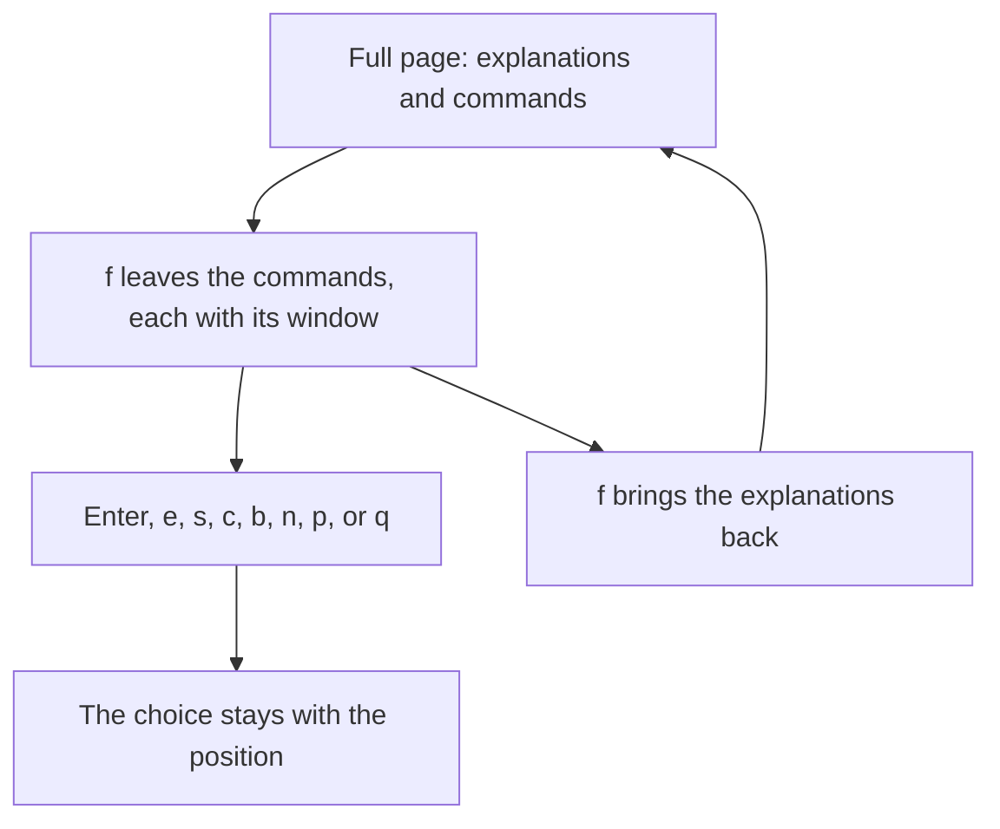

# Feature Specification: Fold the explanations away

**Feature Branch**: `feat/14-fold`
**Created**: 2026-10-23
**Status**: Specified
**Input**: Issue 14, "Fold the explanations away"

## User Scenarios & Testing

### User Story 1 — Fold the page down to the commands (Priority: P1)

A learner who has understood a page presses `f`. The explanations leave. What remains is the commands on that page, each with the window it runs in. Pressing `f` again brings the explanations back. Enter, `e`, `s`, `c`, `b`, `n` and `p` do the same thing in both views. The choice is kept with the position, so turning the page, quitting, and playing again all come back folded or unfolded as the learner left them.

**Why this priority**: This is the whole issue. A learner who already knows the page steps the commands without the prose in the way.

**Independent Test**: In a detached tmux session, `tutorial-stepper play` shows a page that has an explanation, a shown block, an ordinary code block, and commands in two windows. `f` leaves the commands and their windows and drops the rest. Enter runs the marked command. `f` brings the explanation back. No person sits at the keyboard: the test sends the keys.

**Acceptance Scenarios**:

1. **Given** a page with an explanation, a block marked `mode=show`, a code block that is not a command, and commands, **When** the learner presses `f`, **Then** the page shows each command and the window it runs in, and shows none of the explanation, the shown block, or the ordinary code block. The next command is still marked. **When** the learner presses `f` again, **Then** the explanation is back.
2. **Given** the page is folded, **When** the learner presses Enter, `e`, `s`, `c`, `b`, `n` or `p`, **Then** each key does what it does on the full page, and the page stays folded.
3. **Given** the learner folded the page and turned to another page, or quit and ran `tutorial-stepper play` on the same tutorial again, **When** the page is drawn, **Then** it is still folded, and the same next command is marked. **When** the learner unfolds and plays again, **Then** the explanations are back.

### Edge Cases

- A command whose fence names no window is shown with the window it actually runs in, which is the window of the previous command.
- An observation stays, with its window. A block marked `mode=show` does not. A fence without braces does not. Folding one paragraph and leaving the rest is out of scope.
- A page with no command shows no command. The status line stays, and `n` and `p` still turn the page.
- The values in force stay at the top in both views. So does the line that names a status other than the one the block declares, and the line the shell ran.
- `f` toggles while the page is waiting on that status, and after the last command. It does nothing on the set-up script. While a command is running, only `c` is read, as on the full page.
- The choice is one for the whole run, not one per page. `--auto` does not fold anything.

## Requirements

### Functional Requirements

- `f` folds the explanations away. `f` again brings them back. The folded page shows the commands and the observations of the viewed page, each with the window it runs in, and marks the next command the way the full page does.
- Enter, `e`, `s`, `c`, `b`, `n`, `p` and `q` are unchanged by the fold. The page stays beside the window of the next command.
- The run folder records the choice with the position. Turning the page does not change it. `q` writes it. A later `play` of the same tutorial restores it. A position written before this choice existed is unfolded.
- The end-to-end test starts the face in a detached tmux session, folds, steps, and unfolds, and checks that the choice survives another page and a second `play`.
- `tutorial-stepper play --help` names `f` with the other keys. The overview stays one screen.

### Key Entities

- **Folded page**: the viewed page with the explanations left out, each remaining command named with its window.
- **Folded choice**: whether the explanations are hidden, kept with the position in the run folder.

## Success Criteria

- A learner can press `f`, read only the commands and their windows, step with the same keys, press `f` again, and read the explanations.
- Quitting and playing the same tutorial again restores that choice and the same next command.
- `tutorial-stepper play --auto` still plays the conformance examples the way it does today.

