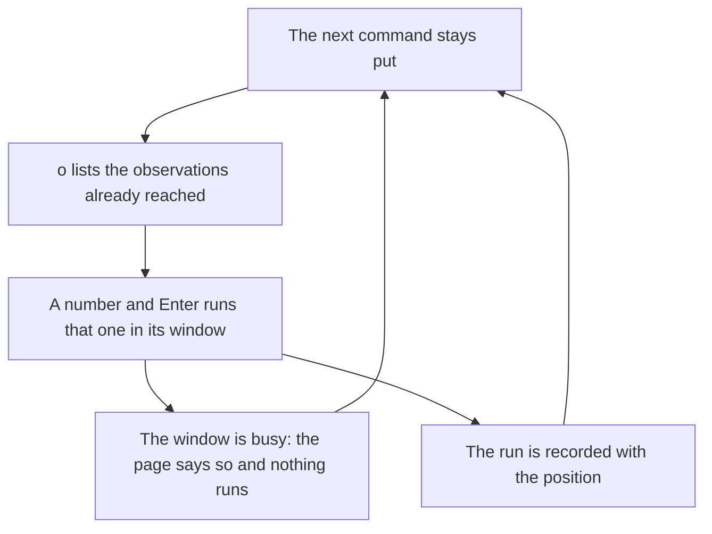

# Feature Specification: Run an observation at any time

**Feature Branch**: `feat/15-observe-face`
**Created**: 2026-10-23
**Status**: Specified
**Input**: Issue 15, "Run an observation at any time"

## User Scenarios & Testing

### User Story 1 — Observe without losing the place (Priority: P1)

A learner who has passed an observation presses `o`. The page lists the observations already reached, each with its window. The learner types a number and presses Enter. That observation runs in its window. The next command stays the next command.

**Why this priority**: This is the whole issue. A learner looks at an effect again without scrolling back and without leaving the place they had reached.

**Independent Test**: In a detached tmux session, `tutorial-stepper play` shows a tutorial with two observations and commands between them. No person sits at the keyboard: the test sends the keys. Before the first observation has been passed, `o` lists nothing. After it has been passed, `o` lists that observation and not the later one. Choosing it runs it. The saved position is unchanged. Choosing it again after another command writes a second record, and the two positions differ. While that window's shell has been given a command and has not reported the end, the page names the window and the observation does not run.

**Acceptance Scenarios**:

1. **Given** a tutorial with an observation, a later command, and a still later observation, **When** the learner presses `o` before the first observation has been passed, **Then** the page says no observation has been reached yet, and neither observation's command is listed. **When** the learner has passed the first observation, by running it or by skipping it, and presses `o`, **Then** the list holds that observation and its window, and does not hold the later one. **When** the learner goes back so that the first observation is the next command again, **Then** the list no longer holds it. Turning the page does not change the list.
2. **Given** the list holds an observation, **When** the learner types its number and presses Enter, **Then** the observation runs in its window, the page shows the line the shell ran, and the next command is unchanged. Enter with no number, or `o` again, closes the list and runs nothing.
3. **Given** the learner chooses an observation whose window was given a command and whose shell has not reported the end of that command, **When** the choice is made, **Then** the page says that window is busy and the observation is not typed. The same is true of Enter when the next command is that observation.
4. **Given** the learner runs one observation from the list at two different places, **When** the run folder is read, **Then** each run is an observation record, and the position on the two records differs. A run that did not happen, because the window was busy or the list was closed, is not recorded.

### Edge Cases

- An observation the learner has not passed is not on the list, including one that is the next command and one that is only visible because the learner turned the page.
- Skipping an observation reaches it. Going back before it takes it off the list.
- A number that is not on the list is named, and the list stays. `q` still quits. Any other key does nothing while the list is open.
- The list is the same when the explanations are folded. `f` does not change while the list is open.
- While a command the page started is still running, only `c` is read, as today. `o` is not read then. `o` does nothing on the set-up script.
- An on-demand run whose status is not the one the block declares is shown and recorded, and the next command stays. Enter after that runs the next command. It does not retry the observation. An in-place run keeps today's retry: Enter retries, `s` skips.
- The in-place run, where the observation appears, is recorded too, at the position it ran, which is that observation's own page and line. The position then advances as it does today.
- `--auto` is unchanged. It still runs every observation again at the end of the path and does not read `o`.

## Requirements

### Functional Requirements

- `o` lists the observations that stand before the next command, in the order they appear, numbered from 1. Each row is the number, the window the observation runs in, and the first line of its command. The page says when none have been reached.
- The learner types a number and presses Enter. That observation is typed into its window by the stepper. The next command does not change. The choice is not kept in the position file.
- Before an observation is typed, the face asks the stepper whether that window's shell has reported the end of the command it was last given. When it has not, the page says `window NAME is busy` and nothing is typed. The face does not decide this by reading the screen.
- Each observation the face runs is appended to the run folder as an `[[observation]]` table with the position at which it ran. The position is the page and the line of the next command, written `PAGE:LINE`, or `done` when the tutorial is finished. A busy window writes no table.
- `tutorial-stepper play --help` names `o` with the other keys. The overview stays one screen.

### Key Entities

- **Reached observation**: an observation that stands before the next command.
- **Observation record**: one run, in the run folder, with the position at which it ran.
- **Busy window**: a window whose shell has not reported the end of the command it was last given.

## Success Criteria

- A learner can press `o`, see only the observations already reached, run one, and find the same next command marked afterwards.
- A busy window is named on the page, and that observation does not run.
- Two runs of one observation, at two places, are two records with two positions.
- `tutorial-stepper play --auto` still plays the conformance examples the way it does today.

