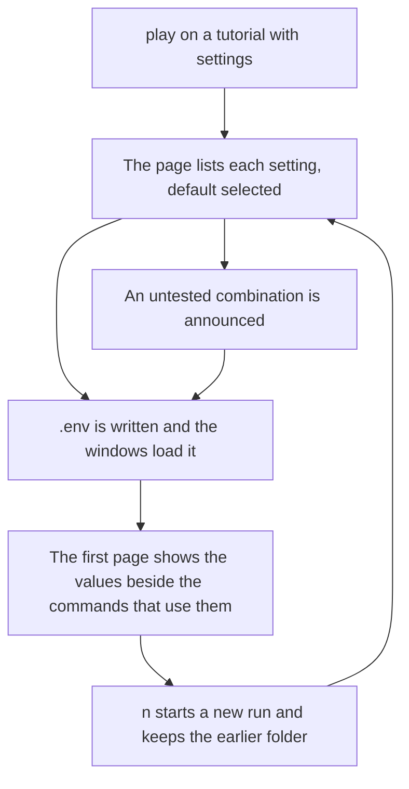

# Feature Specification: Choose settings before the first page

**Feature Branch**: `feat/16-choose-settings`
**Created**: 2026-10-23
**Status**: Specified
**Input**: Issue 16, "Choose settings before the first page"

## User Scenarios & Testing

### User Story 1 — Choose the values, then play (Priority: P1)

A learner starts `tutorial-stepper play` on a tutorial that declares settings. Before the first page, the page pane lists each setting and the values it allows, with the default already selected, and the keys that change the selection are written beside that list. The learner confirms. The chosen values are written to `.env` in the run folder, in the same form the unattended run writes, and the windows load that file. The first page then shows those values beside the commands that use them. A combination that is not a tested path is announced once, and the tutorial plays anyway.

**Why this priority**: This is the whole issue. The unattended run already writes `.env` and selects blocks. The terminal face still plays the defaults and does not ask.

**Independent Test**: In a detached tmux session, `tutorial-stepper play` on a tutorial with two settings shows the choice before any command. No person sits at the keyboard: the test sends the keys. The defaults are already selected. Changing one value to a combination the index does not list as a tested path shows the announcement. Enter writes `.env`, starts the windows, and the page shows the chosen values beside the command that reads them. The other combination's commands are not on the page. Quitting from the choice writes no `.env` and starts no shell.

**Acceptance Scenarios**:

1. **Given** a tutorial that declares settings, **When** the learner starts `play` and no run has chosen yet, **Then** the page pane lists each setting's allowed values with the default selected, and the keys are written beside that list. The first page is not shown yet, and no shell has loaded `.env`.
2. **Given** the choice is showing a combination that is not a tested path, **When** the learner looks at the page, **Then** it says `This combination is not a tested path.` **When** the learner confirms, **Then** that sentence is not repeated on the tutorial pages, and the tutorial plays.
3. **Given** the learner confirms, **When** the run folder is read, **Then** `.env` is one `NAME=value` line per setting, in the order the index declares them, with a newline after each line and no `export`, quotes, or blank line. The windows have those variables. A command whose text reads a setting shows `NAME=value` beside it, for the values in force.
4. **Given** a run that already chose, **When** the learner starts `play` again and asks to choose again, **Then** the earlier run folder is moved aside and is not deleted, and a new run starts at the same path with the choice shown again. Enter on that later visit, without asking to choose again, continues the earlier run.

### Edge Cases

- A tutorial with no settings does not ask. It plays as it does today, and it writes no `.env`.
- A tested combination does not show the announcement. A tutorial that declares no tested path does not show it either: there is no path to miss.
- Quitting from the choice writes no `.env`, starts no shell, and leaves the run folder empty of this run's files.
- The set-up script, when the index names one, is still agreed after the choice and before the first command.
- Choosing again is a new run. It does not change the values of the run already in progress. The earlier folder keeps its `.env`, its position, and the files the commands wrote.
- The unattended run is unchanged. `--path` still selects a tested path and does not read keys.

## Requirements

### Functional Requirements

- Before the first page, and only when the index declares settings and this run has not chosen yet, the page pane lists every setting. Each row shows the allowed values. The default is selected. Up and down, and `k` and `j`, move between settings. Left and right, and `h` and `l`, change the selected value. Enter starts the tutorial. `q` quits. Those keys are written beside the list.
- Enter writes `.env` in the run folder exactly as the unattended run writes it, then starts the windows, which load that file before the first command. The blocks that do not belong to the chosen values are not steps.
- When the selected combination is not one of the tested paths, the choice says `This combination is not a tested path.` Confirming plays the tutorial, and the tutorial pages do not repeat that sentence.
- A command whose text reads `$NAME` or `${NAME}` shows `NAME=value` beside it, for each setting it reads, in the order the index declares the settings. A command that reads none of them shows no such line.
- A later `play` of a run that already chose shows the values in force and offers to continue or to start a new run. Enter continues at the saved place. `n` moves the earlier folder aside, never deletes it, and shows the choice for a new run at the same path. The aside folder is the run folder's name plus `.1`, then `.2`, and so on, beside it.
- `tutorial-stepper play --help` names the choice and stays within the line limit. No new continuous-integration job.

