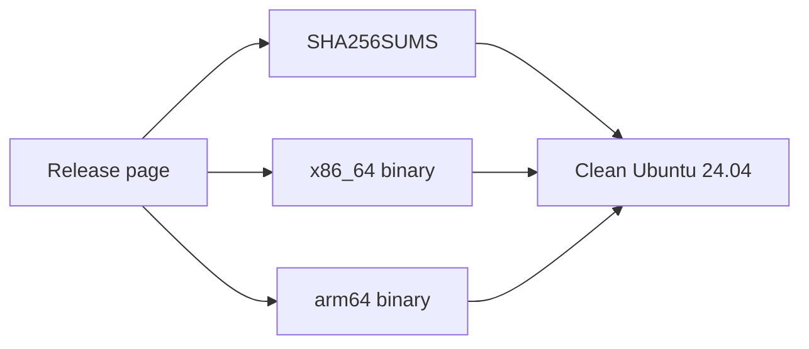

# Feature Specification: Static Linux binaries for x86_64 and arm64

**Feature Branch**: `feat/17-linux-binaries`
**Created**: 2026-10-23
**Status**: Specified
**Input**: Issue 17, "Static Linux binaries for x86_64 and arm64"

## User Scenarios & Testing

### User Story 1 — Install on Linux without Nix (Priority: P1)

A learner on Linux does not have Nix. They open the release page, download the binary for their machine, and check it against the checksums published with that release. `tutorial-stepper --version` prints the release. The same binary can check a tutorial's format. One file is for x86_64. The other is for arm64. Both are statically linked, so neither asks the machine for a C library.

**Why this priority**: This is the whole issue. The release today uploads one Linux binary, under a name that does not say the version or arm64.

**Independent Test**: Build the release artifacts. The directory holds `tutorial-stepper-<version>-x86_64-linux`, `tutorial-stepper-<version>-aarch64-linux`, and `SHA256SUMS`, and nothing else. `sha256sum -c` succeeds. `file` reports each binary statically linked for its architecture. Each binary, run in a clean Ubuntu 24.04 container, prints `--version` and checks an example. A pull request builds both binaries and uploads nothing to the release.

**Acceptance Scenarios**:

1. **Given** a release, **When** a learner opens its files, **Then** the files are `tutorial-stepper-<version>-x86_64-linux`, `tutorial-stepper-<version>-aarch64-linux`, and one `SHA256SUMS` that lists both. The old name `tutorial-stepper-linux-x86_64` is absent.
2. **Given** those two files, **When** they are inspected, **Then** each is a statically linked executable, one for x86_64 and one for arm64, and `sha256sum -c SHA256SUMS` succeeds.
3. **Given** a clean Ubuntu 24.04 container, **When** each binary runs there, **Then** `--version` prints `tutorial-stepper <version>` and that commit, and `check` on an example exits 0. The arm64 binary runs under emulation.
4. **Given** a pull request that changes the release build, **When** continuous integration finishes, **Then** both binaries have been built and nothing has been uploaded to a release. The upload still happens only after release-please creates a release.

### Edge Cases

- `check` needs no tmux and no shell. Playing a tutorial still needs the learner's tmux and bash or zsh. The binary does not bring them, and it installs nothing.
- The version in the file name is the version in the crate manifest, the same version `--version` prints. release-please bumps that manifest. The manifest is not edited by hand here.
- Debian and RPM packages are out of scope, as is macOS.

