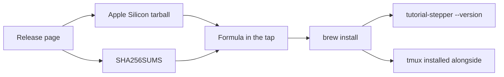

# Feature Specification: macOS binary and Homebrew formula

**Feature Branch**: `feat/18-homebrew`
**Created**: 2026-10-23
**Status**: Specified
**Input**: Issue 18, "macOS binary and Homebrew formula"

## User Scenarios & Testing

### User Story 1 — Install on a Mac with Homebrew (Priority: P1)

A learner with an Apple Silicon Mac does not have Nix. They run `brew install lambdasistemi/tap/tutorial-stepper`. Homebrew installs the stepper and installs tmux alongside it. `tutorial-stepper --version` prints the release. The same installed binary plays a conformance example unattended, once in bash and once in zsh.

**Why this priority**: This is the whole issue. The release today ships Linux binaries only. A Mac user has no formula and no Apple Silicon build.

**Independent Test**: Render the formula from a version and a checksum. The rendered file depends on tmux, names the Apple Silicon tarball, and carries that checksum. Assemble a release directory that holds the two Linux binaries and `tutorial-stepper-<version>-aarch64-darwin.tar.gz`; `SHA256SUMS` lists all three and `sha256sum -c` succeeds. A pull request builds the Apple Silicon binary, installs the formula from a temporary local tap whose archive is that fresh build, and plays `examples/one-window` unattended in bash and in zsh. That pull request does not push to `lambdasistemi/homebrew-tap`. A release uploads the tarball, lists it in `SHA256SUMS`, and pushes `Formula/tutorial-stepper.rb` with a token minted from the organisation's CI app.

**Acceptance Scenarios**:

1. **Given** a release, **When** a learner opens its files, **Then** `tutorial-stepper-<version>-aarch64-darwin.tar.gz` is there, and `SHA256SUMS` lists it together with the two Linux binaries.
2. **Given** that release, **When** the formula in `lambdasistemi/homebrew-tap` is read, **Then** it depends on tmux, its archive is that tarball, and its checksum is the tarball's line in `SHA256SUMS`. The release updated the formula with a token minted from the organisation's CI app, scoped to `homebrew-tap`.
3. **Given** a Mac with Apple Silicon, **When** the learner runs `brew install lambdasistemi/tap/tutorial-stepper`, **Then** `tutorial-stepper --version` prints `tutorial-stepper <version>` and that commit, and tmux is installed alongside.
4. **Given** that installation, **When** the conformance example plays unattended, **Then** it exits 0 in bash and exits 0 in zsh.
5. **Given** a pull request that changes the macOS build, **When** continuous integration finishes, **Then** the Apple Silicon binary has been built, installed from a temporary local tap pointed at that build, and played in bash and in zsh. The real tap is unchanged.

### Edge Cases

- Intel Macs are not built. The binary is not signed with an Apple Developer ID and is not notarised.
- The tarball holds `bin/tutorial-stepper`. Libraries that are not part of macOS, if the link recorded any, sit in `libexec/lib` and the binary loads them from there. A library path inside the Nix store is a failed build.
- The formula depends on tmux and does not depend on bash. Playing a bash tutorial needs bash 4 or newer, because the prompt hook uses bash 4. The bash macOS ships is older than that. zsh is the shell macOS already provides. The macOS continuous-integration job installs a current bash before it plays the bash example.
- The version in the file name is the version in the crate manifest, the same version `--version` prints. release-please bumps that manifest. The manifest is not edited by hand here.
- The Linux release derivation still holds only the two Linux binaries and their checksum file. The checksum file a learner downloads from the release is rewritten, after the Apple Silicon tarball is uploaded, so that it lists all three files.
- `check` needs no tmux and no shell. The formula still depends on tmux, because playing a tutorial needs it.

