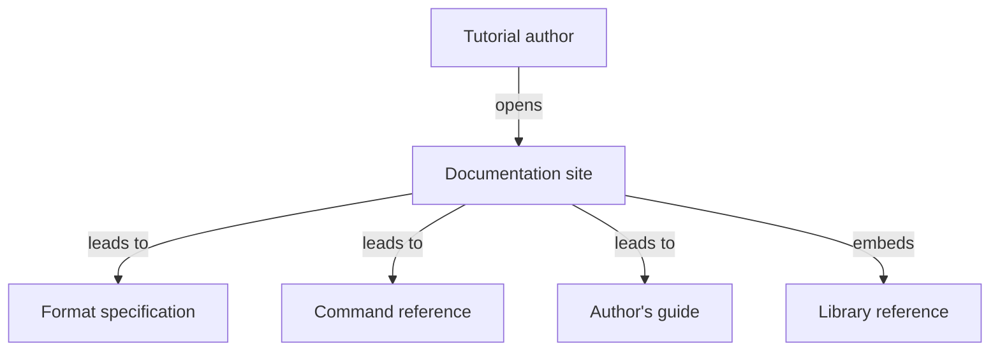

# Feature Specification: Documentation site

**Feature Branch**: `feat/19-docs-site`
**Created**: 2026-10-23
**Status**: Specified
**Input**: Issue 19, "Documentation site"

## User Scenarios & Testing

### User Story 1 — Read the format, the commands, and the author's guide (Priority: P1)

A tutorial author opens the documentation site. The front page states what a learner does and what an author does, and shows how the tutorial, the stepper, the shells, the terminal page, the unattended run, the Killercoda scenario, and the printed script meet. From there the author opens the format specification, the command reference, and a guide that starts from a plain Markdown page and ends with that page playing unattended, the same command continuous integration runs.

**Why this priority**: This is the whole issue. The format and the commands are already written as pages in the repository. They are not a site, they are not built on a pull request, and they are not deployed.

**Independent Test**: Build the site strictly. The front page names the learner and the author and contains one context diagram. The format specification, the command reference, and the author's guide are linked from that page. The guide contains one tutorial that uses the format, including a command fence, and says the command that plays it unattended. A fence with braces and no `mode` is a command. `mode=show` is only shown. `mode=observe` is an observation. A fence without braces is an ordinary code block. Every such block on the site is rendered as an ordinary code block. The built site also contains the library reference generated from this revision.

**Acceptance Scenarios**:

1. **Given** a pull request, **When** continuous integration finishes, **Then** the site has been built strictly, and it has not been deployed.
2. **Given** a push to `main`, **When** the documentation workflow finishes, **Then** the same strict build is deployed to GitHub Pages with `actions/upload-pages-artifact` and `actions/deploy-pages`.
3. **Given** the built front page, **When** an author opens it, **Then** it opens with the learner's story and the author's story and shows a context diagram.
4. **Given** the site, **When** the author follows the reading route, **Then** they reach the format specification, the command reference, and the author's guide, and the guide's worked example is a tutorial that plays unattended.
5. **Given** any tutorial block on the site, **When** the page is rendered, **Then** the block is written as `lang { key=value }` and appears as an ordinary code block.
6. **Given** the built site, **When** the author opens the library reference, **Then** the reference was generated from the same revision as the site and its pages link to one another.

### Edge Cases

- Narration of the pages is out of scope. The presentation check runs without speech companions.
- The theme is Terminal, with a light and dark switch that follows the system until the reader chooses, and then remembers the choice. A static palette setting is not that switch.
- GitHub Pages is enabled in workflow mode by the parent. This change supplies the workflow and does not call the GitHub API.
- The workflow runs on the organisation's NixOS runners. The new pull-request job is a required check. The deploy job runs only on `main` and is not a required check.
- release-please keeps cutting releases. The release manifest is not edited by hand.
- Intel Macs are not built. The macOS binary is not signed with an Apple Developer ID and is not notarised. The site says so where it tells a learner how to install.
- A diagram is rendered in a browser and looked at, in light and dark, at a desktop width and a phone width. A count of diagram fences is not that look.

